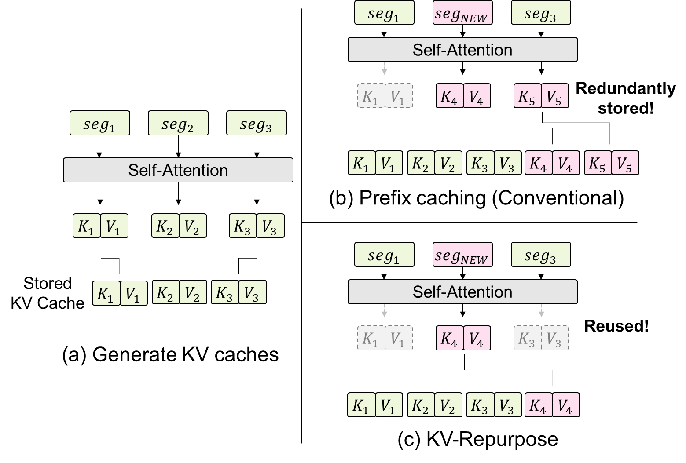
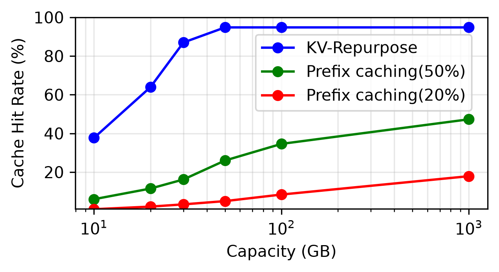
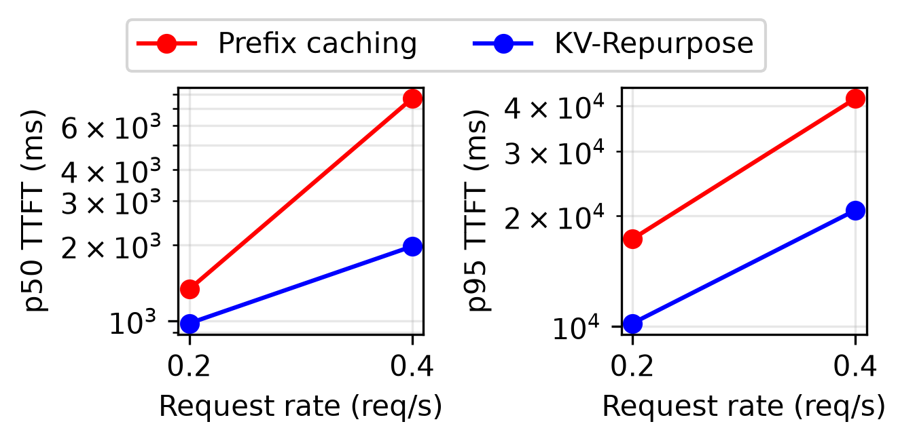

# KV-Repurpose: A Testbed for Evaluating Non-Prefix KV-Cache Reuse

> Kioxia（闪存厂商）出品。解决 RAG 场景下「同一篇文档换个前缀就复用不了 KV cache」的问题，给出了一个跑在 120B 模型上的开源试验台。

## 背景与动机

prefix caching 像图书馆只按「索书号开头一模一样」借书：你的请求开头和之前某条完全一致（同一个 system prompt + 同一段对话历史），就直接复用算好的 KV，跳过重复 prefill。问题出在 RAG：同一篇文档这次跟在 system prompt A 后面、下次跟在 system prompt B 后面，前面多了一个时间戳、后面文档顺序也换了——开头对不上，整篇文档的 KV 就得从头重算。可这些 KV 的内容明明一字没变，白白多算一遍。

更糟的是存储：同一篇 64K 文档配 100 个不同前缀请求，prefix caching 可能存下 100 份带前缀的拷贝。Kioxia 做存储的，对「缓存仓库膨胀」天然敏感——这也是论文用 NVMe 存 KV、算容量账的背景。

论文的定位很克制：不是提出 SOTA 方法，而是搭一个**简单可复现的试验台**（vLLM 扩展，不到 900 行 Python），把「非前缀复用到底值多少、naive 复用什么时候质量会塌」这两个问题放到 100B+ 模型上量清楚。

### 关键图表

**图 1：动机——prefix mismatch 导致复用失败**

> 同一段文档内容（金色）出现在不同请求的不同位置：前缀不同 → prefix caching 全部 miss → 文档 KV 重算 + 重复存储。KV-Repurpose 把文档段 KV 单独存一份，位置不对就用 RoPE 重对齐，任意前缀后都能复用。

**表 1（转 markdown）：naive 复用的质量账——单文档没事，跨文档塌方**

| 任务（指标） | QASPER（单文档 QA） | HQA（多文档） | 2WMQA（多文档） | MuSiQue（多文档） | QMSum（单文档摘要） | GovReport（单文档） | M-News（多文档） |
|---|---|---|---|---|---|---|---|
| 无上下文 | 0.04 | 0.11 | 0.12 | 0.11 | 0.07 | 0.03 | 0.04 |
| 重算（参照） | 0.42 | 0.71 | 0.80 | 0.61 | 0.20 | 0.26 | 0.22 |
| **Repurp** | **0.42** | 0.60 | 0.50 | 0.40 | **0.19** | **0.26** | 0.17 |

> 单文档 QA/摘要几乎无损（QASPER 完全持平）；多文档推理明显掉（2WMQA 0.80→0.50，掉 3 成多）。原因：多文档拼接时文档间的相对位置被重排，跨文档的 attention 依赖被 naive RoPE 重对齐破坏。附录 A.5 用「只保留相关文档」做了 oracle 诊断：部分恢复但差距仍在——说明不只是文档数量问题，拼接方式本身就在丢信息。

**图 3：容量 vs 命中率（核心系统结果）**

> 同样 30GB 缓存：KV-Repurpose 命中率 63.9%，prefix caching 只有 3.3%（20% 固定前缀配置）/ 16.2%（50% 配置）。prefix caching 堆到 1TB 也只到 17.9%——同一文档在不同前缀下的重复拷贝把缓存挤爆了，多存 33 倍还是追不上。

**图 4：TTFT 尾延迟**

> 命中率的差距直接传导到延迟：30GB 缓存、Poisson 到达的 Zipf 负载下，KV-Repurpose 的 p50 和 p95 TTFT 都明显低于 prefix caching。p95 的改善尤其大——缓存 miss 的重 prefill 正是长尾的来源。

## 方法

两个组件，架构是「改造的 vLLM + 前置 proxy」：

**1. vLLM 扩展：段级 cache-aware 调度 + 位置重对齐（§2.1）**

- 输入用特殊分隔符（`<|reserved_200016|><|reserved_200017|>`）切段，**每段独立**查缓存：这段命中就跳过 prefill 复用，没命中就正常算并存下来。前面的段 miss 不影响后面的段复用——这是和 LMCache（首块 miss 后全部放弃）的关键区别。
- 位置处理是全文最「轻」也最关键的一招：**Key 存「未旋转」形态，复用时按新位置现做 RoPE**。只重对齐 key 的位置编码，不重算与前文的 attention。就这么简单的位置修正，单文档场景质量几乎不掉。

**2. Proxy server：pseudo-retrieval + prompt 构建 + 容量管理（§2.2）**

- 伪检索：按问题直接查预设的「问题→文档」库，绕开真实检索器的噪声，让缓存行为可复现评测。
- 缓存生成有个讲究：文档 KV 用**专用请求**（`{专用 system prompt}{doc}`）单独生成，绝不在用户请求里顺手生成。原因见下面「跨段信息泄漏」——前文内容会渗进段的 KV 表示里，用户敏感信息可能跟着缓存泄漏给后续复用者。
- 容量管理就是朴素 LRU，超限逐出最久未用的段。

**跨段信息泄漏（附录 A.2，最意外的发现）**

生成缓存时在文档前塞一句「My name is {姓名}」，只缓存文档段的 KV——姓名根本不在被缓存的段里。复用这份缓存回答问题时，**35% 的姓名被模型复述了出来**。对照组（不带姓名前缀生成）零泄漏。结论：前文信息会隐式写进后续段的 KV 表示。工程含义直接写在设计里——共享文档缓存必须用干净前缀离线生成，这也是所有做 KV 复用的系统都该注意的安全坑。

## 实验

模型 GPT-OSS-120B，单张 H200，KV 存 NVMe（vLLM v0.20.0 扩展）。

- **质量（LongBench 7 数据集 + LongBench Pro 25 任务）**：单文档 QA/摘要基本无损；多文档推理明显掉点（见表 1）。LongBench Pro 上 25 任务平均 0.43 vs 重算 0.45，接近。
- **命中率**：Zipf 负载（2500 请求，LongBench Pro 8K–128K 文档），30GB 缓存 63.9% vs 3.3%/16.2%；1TB 下 prefix caching 也只 17.9%/47.3%。
- **TTFT/吞吐（§4.4 微基准）**：上下文 >16K 起 KV-Repurpose TTFT 更低；高请求率下 prefix caching 先饱和（miss 的重复 prefill 吃光 GPU），KV-Repurpose 大多数高负载档位保持更高吞吐。
- **容量外推（附录 A.4）**：拿维基百科全天页面浏览量估算——只存最热的 0.2% 页面（约 1.7TB KV）就有 14.55% 命中率、省 23.7% prefill；而 prefix caching 因前缀各异，命中率理论上限被「同用户重访」卡在 20%，要顶到这个上限还得 2.8PB 存储。这笔账是 Kioxia 写这篇论文的真正动机：**文档级共享缓存把「需要多少存储才能命中」的关系从乘法变成除法**。

## 复现要点

- **代码**：<https://github.com/taiga333/eval-kv-repurpose>（Apache-2.0，vLLM v0.20.0 扩展 + proxy）
- **硬件门槛**：论文配置 GPT-OSS-120B + H200 200GB + NVMe。可用 GPT-OSS-20B + 单张 80GB 卡降级复现，KV 仍走 NVMe/本地 SSD。
- **最小路径**：clone → 起 vLLM（`kv_connector: RepurpConnector`）→ 注册 pseudo-retrieval 库 → 起带容量上限的 proxy → 用 GuideLLM 打 Zipf 负载，Prometheus/Grafana 看命中率。
- **关键超参**：缓存容量上限（论文扫了 GB 级到 1TB）、固定前缀比例（20%/50% 两档）、文档段切分（分隔符写死）。
- **注意**：多文档 QA 的掉点是 naive RoPE 重对齐的天花板，不是 bug；要救这块得换 CacheBlend/EPIC 一类的 KV 融合方法（论文明确说自己没做）。

## 启发与局限

- 「位置重对齐就能复用」比预想能打的场景多：单文档 QA/摘要、整篇论文/网页当一段的 RAG，naive 方法就够。多文档拼接推理是明确的失效边界。这条边界本身就有价值——它告诉系统设计者什么负载值得上重型 KV 融合，什么负载轻量方案就行。
- 跨段信息泄漏是个被普遍忽视的安全问题：段的 KV 不只编码段内内容，还会吸入前文信息。任何「缓存共享给多用户」的设计（企业 RAG、多租户 serving）都该检查缓存生成的前缀是否干净。这篇用 35% 泄漏率把这个坑量化了出来。
- 附录 A.4 的容量外推思路值得借鉴：拿真实访问分布（Zipf）+ 存储比例常数估算「缓存仓库该建多大」，把系统论文的实验外推到生产尺度。也解释了存储厂商为什么做 serving 系统研究——KV 仓库是新的热数据层。
- 局限：单一模型（GPT-OSS-120B）单一实现；naive 位置修正没有与 CacheBlend/EPIC 对比或组合（作者自己列为 future work）；分隔符切段要求上游配合改 prompt，对不感知缓存的调用方有侵入性。

## 疑问清单

1. Key 存未旋转形态复用时现做 RoPE，对非 RoPE 位置编码的模型（ALiBi、NoPE）或 GPT-OSS 的 MoE attention 结构是否同样轻量可行？论文只测了 GPT-OSS-120B。
2. 多文档掉点里「相对位置重排」与「绝对位置偏移」各占多少？把文档顺序固定、只改绝对位置（不同前缀长度）做消融，能否把掉点归因拆干净？
3. 跨段泄漏（A.2）只测了 100 个姓名的复述率；更强的提取攻击（注入指令「泄露前文所有内容」）成功率多高？缓存共享系统需要什么级别的防御？
