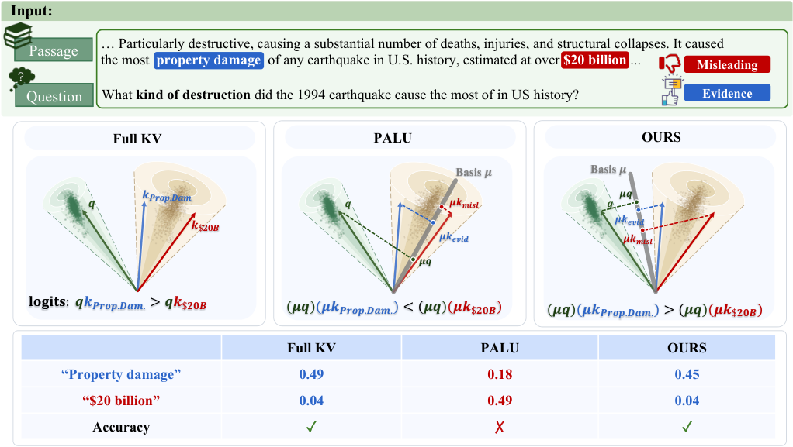
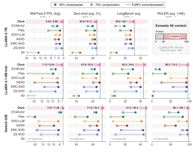
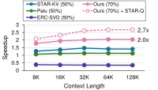

# BELT: BEhavior-Aligned Low-Rank KV Cache Compression

> 原文：[abs](https://arxiv.org/abs/2610.17966) · [PDF](https://arxiv.org/pdf/2610.17966)

> 北大 + 京东 + 腾讯出品。低秩压缩 KV cache 的两个老问题：压缩目标只顾「像不像」不看「注意力行为对不对」、rank 分配一刀切。BELT 把 key 侧目标改成保注意力分布（有闭式解），rank 用可微 top-k 全局学出来。70% 压缩下 LongBench 反超最强基线 23.3 分，叠 3-bit 量化总压缩 17.8×。

## 背景与动机

长上下文推理的显存大头是 KV cache。低秩分解是压缩手段之一：把 K/V 投影矩阵 `W_K, W_V`（d×d_h）近似成 `W_down·W_up`（d×r），缓存只存 `X·W_down`（n×r），每 token 显存从 d_h 降到 r。像把一本厚账本浓缩成摘要卡片——问题是浓缩的「标准」怎么定。

现有方法的标准有两个毛病：

1. **目标错位**。主流做法最小化 KV 重建误差（SVD-LLM/ASVD 等），把 K 压得再像也没用——注意力是 `softmax(qK)`，key 的误差经过 query 交互和 softmax 非线性放大后，注意力分布可能完全走样，答案直接错。SOTA 的 A³ 进了一步瞄准 pre-softmax logits，但 logits 对 ≠ 概率对 ≠ 输出对。论文图 1 给了个直观例子：保留主奇异方向 μ 后 `(qμ)(μk)` 可能把该attend 的 token 排到后面，输出答案改变。
2. **rank 分配粗糙**。统一 rank 无视各 head 的压缩敏感度差异；STAR-KV 学每块阈值但论文分析出其阈值会「扎堆」，全局预算约束并不精确。

## 方法

### Key 侧：保注意力分布的目标 + 闭式解

BELT 的出发点是端到端的：让压缩前后**注意力输出** `o_x` 尽量一致。直接优化这个目标 K/V 互相纠缠解不动，论文推导出一个上界分解（式 2）：

`J ≤ 2·L_V + 4M²·L_K`

- **V 侧** `L_V`：注意力输出对 V 的依赖是线性的（softmax 之后乘 V），加权 SVD 有精确闭式解（定理 1，Eckart-Young 定理直接用）。这部分与 A³ 同源，作者明说不算自己的贡献。
- **K 侧** `L_K`：**这是论文的主贡献**——目标定为注意力分布的 KL 散度 `D_KL(a(W_K) ‖ a(Ŵ_K))`，直接盯 softmax 之后的概率分布。softmax 非线性没法闭式解，但可以在当前解附近做 Taylor 展开 + Kronecker 分解，得到二次代理目标 `L_K≈`，它和 V 侧同构，同样有加权 SVD 闭式解。近似误差有显式界（Kronecker 截断 + Taylor 两项），实验验证在低秩解处都很小。

直观理解 K 侧目标的变化：以前问「K 压缩后还像原来的 K 吗」，现在问「用压缩后的 K 算出来的注意力权重还和原来一样吗」——后者才是模型行为真正关心的。而且这个目标天然是 query-aware 的：softmax 的曲率项 `J_x = diag(a) − a'a` 会给「注意力敏感的 query 位置」更大权重。

RoPE（旋转位置编码，非线性且夹在 K 投影之后）让 `W_up_K` 没法做 weight absorption（V 侧可以把 `W_up_V·W_O` 预乘掉），附录 D 处理了 RoPE 和 GQA 的推广。

### Rank 分配：可微 top-k，全局预算硬约束

把所有层所有 head 的 K/V 块串起来（共 N 块），每块的奇异分量按分值 `t_ij = s_i − j` 排序（s_i 是每块可学习的分数，j 是分量序号）。训练时用 sigmoid 软门控 `g_ij = σ((t_ij − α)/τ)`，共享截断 α 用 Newton 法解出使门控质量恰好等于预算 b——**松弛预算精确满足**；部署时硬选 top-b 个分量。每块至少留 1 个分量。关键差别：训练目标是 KD loss（压缩前后输出对齐），梯度通过隐函数微分流过 α。

### 与量化正交组合

压缩表示的前几维主导量化范围，Palu/STAR-KV 的量化器会先做正交变换摊开 outlier。BELT 把这些变换离线融进因子，零推理开销，任意学的 rank 都能配正交矩阵、不用重训。

### 关键图表

**图 1：动机——KV 重建对 ≠ 注意力对**

> 左：全注意力；中：vanilla SVD 保留主特征向量 μ，`qK` 变 `(qμ)(μk)`，μ 只由上下文 token 决定、无视后续 query，注意力分布被扭曲、答案错；右：BELT 的特征向量对齐 query/key 分解，保住注意力输出、答案对。[arXiv 原图](https://arxiv.org/html/2610.17966v1#S1.F1)

**图 2：主结果——50%/70% 压缩下的质量**

> LLaMA-2-7B / LLaMA-3.1-8B / Qwen3-32B 上的 perplexity（反向对数轴）、zero-shot、LongBench、RULER。深色 50%、浅色 70%；虚线是未压缩模型。基线在 70% 处大面积崩塌，BELT 只轻微退化；50% 时 LongBench 甚至反超未压缩的 LLaMA-3.1-8B。A³ 不适用于 Qwen3-32B（其 QK norm 夹在投影与 RoPE 之间）。[arXiv 原图](https://arxiv.org/html/2610.17966v1#S4.F2)

**图 3：注意力模块加速**

> LLaMA-2-7B 单步 decode、batch 16、32 层的注意力模块相对 SDPA(FlashAttention-2) 加速比，不同上下文长度下：BELT@70% 已超过所有基线@50%（等精度比较），STAR-KV/Palu 卡在 1.5× 以下，ERC-SVD 甚至比不压还慢；虚线叠加 STAR-Q 后优势随上下文变长扩大。[arXiv 原图](https://arxiv.org/html/2610.17966v1#S4.F3)

**Table 2（转 markdown）：Qwen3-32B 量化组合**

| 方法 | 平均 bit | 压缩比 | Zero-Shot(%) |
|---|---|---|---|
| 未压缩 | 16 | 1× | 71.29 |
| Palu | 3.0 | 10.7× | 48.43 |
| STAR-KV | 3.4 | 9.7× | 63.30 |
| KIVI-2 | 2 | 8× | 67.90 |
| BELT+Palu-Q | 2.7 | 13.3× | 70.12 |
| BELT+STAR-Q | 2.1 | 16.7× | 70.28 |
| **BELT+Palu-Q 3-bit** | **1.97** | **17.8×** | 69.36 |

> 低秩压缩攒下的精度余量直接兑现成量化收益：17.8× 压缩只掉 1.9 分。

## 实验

- **设置**：4 个模型（LLaMA-2-7B/MPT-7B 为 MHA，LLaMA-3.1-8B-Instruct/Qwen3-32B 为 GQA；前三 RoPE、MPT NoPE）；准确率测 WikiText-2/C4 困惑度、LM-Eval-Harness 六任务、LongBench、RULER(16K)；系统测速在单张 RTX PRO 6000 (96GB) FP16。
- **质量**：70% 压缩下 Qwen3-32B LongBench 超最强基线 23.3 分、RULER 13.8 分；基线多处崩塌而 BELT 与未压缩差距很小。检索密集型任务（Qasper/TriviaQA）受益最大——与动机一致（query-key 匹配主导检索）；摘要类不敏感。
- **微调对比**：BELT 不动权重；即便允许基线微调、BELT 也加微调，基线仍落后（Table 1）——闭式解避开了随机初始化训练的局部极小。
- **速度**：注意力模块最高 2.7×（STAR-Q 加持）；端到端 decode 吞吐最高 **3.3×**（大 batch + 量化缓存腾出的显存装更多请求）；KV 显存省 87%。
- **消融**：K 侧 KL 目标 vs logit 重建 vs K 重建，行为对齐目标全面占优；学出来的 rank 分配确实非均匀、与敏感度对齐。

## 复现要点

- **代码**：摘要与正文未见开源链接（论文未附 repo），需关注作者后续
- **依赖**：Triton（自写 GPU kernel）、Palu / STAR-KV 量化器（离线融合变换）
- **校准**：小规模校准集 X 上算加权 SVD 分量并冻结，再学 rank 分数 s_i（KD loss + 隐函数微分）
- **模型覆盖**：MHA + GQA + RoPE + NoPE 四种组合都有配方（附录 C/D）
- **最小复现路径**：LLaMA-2-7B + WikiText-2 校准 → 定理 1/推论 1 闭式分解 → 50% 压缩跑 LongBench 对比 Palu
- **注意**：A³ 类方法遇到 QK-normalization 架构（如 Qwen3）会失效，BELT 处理了这种情况

## 启发与局限

- 「重建误差 → 行为对齐」的思路对一切压缩任务通用：量化、剪枝、蒸馏的目标都可以问一句「你优化的是中间量的相似度还是最终行为的相似度」。K 侧用 KL(注意力分布) 做目标、Taylor 展开成二次再闭式解，这条推导链很漂亮，值得在其他非线性模块上复用。
- rank 分配的「可微 top-k + 精确预算松弛」是个干净的模板：软门控训练、硬选择部署，比启发式敏感度搜索可复现性好。
- 低秩与量化是正交轴（hidden 维 vs bit 宽），组合收益来自低秩侧攒的精度余量——「压缩预算应该跨轴全局分配」是 MultiAlloc（同日 2610.18642）共同的洞察。
- 局限：K 侧闭式解依赖 Taylor/Kronecker 近似，论文自己声明只在实测低秩解附近小、无全局一致保证；闭式解按校准集冻结，跨分布漂移时 rank/分量是否仍最优未讨论；GQA 侧的推导在附录里处理但没单独消融。

## 疑问清单

1. 校准集的 query 分布直接决定 K 侧 KL 目标的权重——换一个应用域（代码 vs 对话）rank 分配会漂多少？是否需要按域重校准？
2. 与 token 驱逐类方法（H2O/SnapKV 等）组合会怎样？低秩砍 hidden 维、驱逐砍序列维，理论上也正交，但误差可能相乘放大。
3. 3.3× 端到端吞吐里有多少来自「量化缓存省显存 → 更大 batch」而不是压缩本身？单独压 batch 的对照数字没给全。

## 新学到的术语

- **Behavior-Aligned Compression**（learning）：压缩目标盯最终行为（注意力分布/输出）而非中间量重建误差；softmax 曲率项让目标 query-aware
- **Learned Rank Allocation**（learning）：跨层跨 head 学 rank 分配——软门控 top-k 训练 + 硬预算部署，替代统一 rank 或启发式敏感度搜索
- **Palu**（learning）：低秩 KV cache 压缩与量化的代表方法系列（含 Palu-Q 量化器），BELT 的组合基线
- **STAR-KV**（learning）：自适应 rank 控制的 SOTA 低秩 KV 压缩方法（学习块阈值），BELT 的主要对比对象
