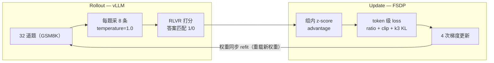

# GRPO 训练全流程数值模拟

[RL 综述精读笔记](2026-10-14-llm-rl-complete-guide.md)的下半场。那边把算法讲清楚了，这边搭一次真实训练：数据集、模型、rollout（用当前模型采样答案）、打分、更新权重，每一步用具体数字走一遍。数字全部是模拟的，公式全部来自博客的 PyTorch 伪代码，没有自创环节。

## 设定

| 项 | 选择 | 说明 |
|---|---|---|
| 数据 | GSM8K train，7473 题 | 小学数学应用题，标准数据集 |
| 奖励 | RLVR：从 completion 里提取 `\boxed{}` 内容，归一化后与标准答案字符串匹配 | 对 1 错 0；CPU 上跑，零 GPU 开销 |
| policy | Qwen2.5-1.5B-Instruct，bf16 | 初始权重 |
| reference | 初始权重的冻结副本 | 只算 KL 用 |
| rollout 引擎 | vLLM，与训练同卡分时复用 | 和 learner 交替占用，不冲突 |
| 训练引擎 | FSDP + AdamW | |

超参（verl/TRL 的常见档位）：

- 组大小 G=8（每题采 8 条），每步 32 题 → 256 条 completion
- temperature=1.0——必须保留随机性，否则组内没有「互相改卷」的素材
- lr=1e-6，clip ε=0.2，KL β=0.04（k3 估计器（只看实际生成 token 的两个模型 logprob 差构造的 KL 采样估计，非负且方差低）；博客伪代码默认 0.1，DeepSeekMath 原文用 0.04）
- num_grpo_epochs=4（一批 rollout 数据复用 4 次）
- completion 上限 1024 token

显存账，按综述的拇指规则（推理 ~2GB/1B 参数、训练 ~16GB/1B）：

- policy 训练态：1.5 × 16 ≈ 24GB（权重 + 梯度 + 优化器状态）
- reference 推理态：1.5 × 2 ≈ 3GB
- vLLM 权重 + KV cache：~4-6GB
- 激活值（256 条 × ~600 token，开 gradient checkpointing）：~3GB

合计 ~35-40GB，单张 A100-80G 放得下。同样的配置换 PPO：还要加一个训练态 critic（+24GB，难训的那种显存）和一个推理态 reward model（+3GB）。GRPO 删掉的就是这两个名额，代价是 rollout 侧 8 倍采样。

## 主循环

一步 = 转一圈。下面走第 1 步。

## Step 1 · rollout：vLLM 写出 256 份答案

32 道题从 GSM8K 抽出，第一道（GSM8K train 真实的第 1 题）：

> Natalia sold clips to 48 of her friends in April, and then she sold half as many clips in May. How many clips did Natalia sell altogether in April and May?
>
> （4 月卖了 48 个，5 月卖一半即 24 个，共 72 个。prompt 里另加指令：reason step by step, put your final answer within `\boxed{}`.）

每题采 8 条。这道题的模拟结果：

| # | 对错 | tokens | 发生了什么 | reward | A |
|---|---|---|---|---|---|
| 1 | ✓ | 214 | 干净四步：48/2=24，48+24=72 | 1 | +1.29 |
| 2 | ✗ | 190 | 算滑：48/2 写成 28 → 76 | 0 | −0.77 |
| 3 | ✓ | 356 | 解对了，末尾追加自检（"wait, let me verify"） | 1 | +1.29 |
| 4 | ✗ | 172 | 列错式：直接写 48−24 | 0 | −0.77 |
| 5 | ✗ | 245 | 啰嗦到尾没写 `\boxed{}`，格式失败 | 0 | −0.77 |
| 6 | ✓ | 198 | 换一条路径解对 | 1 | +1.29 |
| 7 | ✗ | 420 | 想太多，中途改答案 → 70 | 0 | −0.77 |
| 8 | ✗ | 180 | 「一半」理解成两倍 | 0 | −0.77 |

留意 3 号答案里的 "wait"：这类反思词在基座里概率低，恰是 CISPO 要保护的 token——500 步后见分晓。

体感：256 条、平均 ~300 token，vLLM 连续批处理，1.5B 模型几十秒。

## Step 2 · 打分：字符串匹配代替 reward model

提取 `\boxed{}` 内容，去空格逗号，与 "72" 比。256 条不到一秒，零 GPU。可验证性的价值不在省事，在防作弊：神经 reward model 会被学会骗（reward hacking：让打分器给分，而不是把题做对），字符串匹配没有可利用的电路。RLVR 撑得起大规模，靠的就是这个。

本题：rewards = [1, 0, 1, 0, 0, 1, 0, 0]。

## Step 3 · 组内 advantage：互相改卷

mean = 3/8 = 0.375；总体标准差（伪代码 `correction=0`，除以 G 不除 G−1）= √(3×0.625² + 5×0.375²)/√8 = √0.234 ≈ 0.484。

- A_对 = (1 − 0.375) / 0.484 ≈ **+1.29**
- A_错 = (0 − 0.375) / 0.484 ≈ **−0.77**

对的那条，每个 token 挂 +1.29 的信号；错的每 token −0.77。prompt token 和 padding 全部 mask 掉，序列级 A 广播到该 completion 的所有 token。

注意不对称：|+1.29| > |−0.77|，少数派永远拿更大的 |A|——信号最强的时刻是「刚刚能做对」的难度区。

## Step 4 · 两次前向：钉死 old 和 ref logprob

learner（FSDP 侧）对 input_ids = prompt + completion 各过一遍 no_grad 前向：

- **old logprob**：用 rollout 时的权重。vLLM 吐的是 token id，概率要在 learner 重算（两个引擎数值不一致的问题见 Step 6）
- **reference logprob**：用冻结的初始模型

这两个张量（256 × L）在本批 4 次更新里恒定不变。

## Step 5 · 4 次更新：一个 token 的账本

先把诚实话说在前面：lr=1e-6 时一次更新只会挪动某个 token logprob 约 0.001-0.01。下面的数字把漂移夸大约一个数量级，机制才看得见；真实运行里同样的机制在 0.01 的尺度上发生。

取 1 号 completion 里 "72" 的首 token（分词为 "7"）：它在对的答案里，A = +1.29。

**更新 1**（当前权重 = rollout 权重，logprob = −3.20；reference 给 −3.30，policy 还没离开初始模型，两者接近）：

- ratio = exp(−3.20 − (−3.20)) = 1.0，clip 区间内
- policy loss = −min(1.0 × 1.29, 1.0 × 1.29) = −1.29
- k3 = exp(ref−cur) − (ref−cur) − 1 = exp(−0.1) + 0.1 − 1 ≈ 0.005，KL 项 = 0.04 × 0.005 ≈ 0.0002
- token loss ≈ −1.29，梯度 ≈ −1.29 → 该 token 的 logprob 被**推高**

对照组：2 号 completion 里 "28" 的 "8"（A = −0.77），梯度 ≈ +0.77 → 被**压低**。

**更新 4**（同一批数据复用第 4 次，该 token logprob 累计升到 −2.86，模拟值）：

- ratio = exp(−2.86 + 3.20) = exp(0.34) ≈ 1.40 > 1.2 → **clip 触发**
- policy loss = −min(1.40 × 1.29, 1.2 × 1.29) = −1.55（clip 项更小，悲观下界生效）
- k3 = exp(−0.44) + 0.44 − 1 ≈ 0.084，KL 项 = 0.04 × 0.084 ≈ 0.003
- 关键变化：min 选中的是常数项（1.2 × A），policy loss 对该 token 的梯度为**零**——奖励通道被 clip 掐断，只剩 KL 缰绳在轻轻往回拉：β·(1 − exp(ref−cur)) = 0.04 × 0.36 ≈ 0.014，方向是压低 logprob、靠回 reference

这正是「只拦锦上添花」的象限：A>0 且 ratio 上行，过了 1.2 奖励不再加码。反过来不设防——错误 completion 里某个 token 概率被推高越过 1.2（A<0、ratio>1.2）时，min 会选未 clip 项，梯度全力度往下压，没有上限。

**聚合**：序列内 (loss×mask).sum / mask.sum（每 token 平均），再对 256 条取均值。DAPO/Dr. GRPO 的靶子就是这里：先除序列长度，长答案每个 token 的权重被稀释——长度偏见的种子，见下节。

## Step 6 · 权重同步（refit）

4 次更新后 learner 与 vLLM 的权重分叉了。把新权重重载进 vLLM（或传 delta），下一轮 rollout 用新策略。上面模拟的是理想情形：old logprob 在 learner 重算，与采样分布一致。实际 vLLM 常跑 int8/fp8，即便权重相同，两边吐出的 token 概率也有系统差——TIS（截断重要性采样：在梯度里乘一个引擎修正比并截断上限，吸收双引擎概率差）为此而生，verl 已内置。

## Step 7 · 循环

第 2 步换一批新题。数据严格 on-policy：用过即弃，唯一的复用发生在批内那 4 次，靠 clip 兜底。转 500 圈就是一次完整训练。

## 500 步后的宏观图景

- **批量正确率**：前 10 步 ~0.55（Qwen2.5-1.5B-Instruct 基线水平；前文的 3/8 是采样方差），step 100 ~0.65，step 300 ~0.75，step 500 ~0.80+ 后进入平台期——1.5B 在 GSM8K 的天花板大致在此。
- **空组**：8 条全对或全错时 std=0，整组 A 归零（分母的 1e-8 保证不爆炸），一整组 rollout 白跑。训练早期全错组多、后期全对组多，中间才是有效学习区——DAPO 的 dynamic sampling 就是把空组扔掉重采到满批。
- **少数派携带信号**：一组 7 对 1 错时，那条错答案 A = −2.65，对的一条只有 +0.38。正确率越高，学习越依赖少数错例，这也是后期变慢的原因之一。
- **答案变长**：序列内平均稀释长答案 token 权重 + 自检步骤确实拿分，平均 response 从 ~250 涨到 ~400 token。Dr. GRPO 的去 std 分母、固定常数除数是解药。
- **entropy collapse（策略越来越自信、探索性消失）**：temperature 恒为 1.0，但几百步后分布收窄到「赢面大的路径」，组内 8 条答案趋同。DAPO 把 clip 上限提到 0.28（clip-higher）就是给低概率探索 token 松绑。
- **KL 缰绳**：前 100 步 policy 贴着 reference，k3 项近乎零；step 300 起可感知。大规模 reasoning RL 干脆弃用——训练目标就是让模型大变。
- **时间账**：每步几分钟（rollout 占大头），500 步约 1-2 天单卡。32B 模型或更大批次就要上多卡异步——从那里开始是推理 Infra 的领地。

## 零件对照

| 本笔记步骤 | 对应零件 | 综述/精读笔记出处 |
|---|---|---|
| 设定 | RLVR、两模型 vs PPO 四模型 | 方法 · 奖励来源 / PPO 全家福 |
| Step 1 | G=8 组采样 | 方法 · GRPO |
| Step 2 | 规则验证器 | 方法 · RLVR |
| Step 3 | 组内 z-score advantage | 方法 · GRPO |
| Step 4 | old/ref logprob 恒定 | 方法 · importance ratio |
| Step 5 | ratio + clip + k3、批内 4 次更新 | 方法 · GRPO / 三个公共零件 |
| Step 6 | refit、TIS | 方法 · GRPO++（TIS） |
| 500 步 | 长度偏见、空组、entropy、KL 弃用 | 方法 · GRPO++（DAPO / Dr. GRPO / CISPO） |

## 遗留问题

1. 3 号答案的 "wait, let me verify" 这次拿了分，但它在基座里概率低。若批内多次更新后它的 ratio 先触顶被 clip（CISPO 的诊断），这个行为在 500 步里会消失还是靠偶然幸存？
2. 模拟假设 learner 重算 old logprob 保证一致性。完全异步架构下（learner 更新时 vLLM 同时在 rollout），策略滞后带来的 ratio 偏差有多大，TIS 的截断上限 ρ 需要设到多少才盖得住？

---

返回[精读笔记](2026-10-14-llm-rl-complete-guide.md)。
