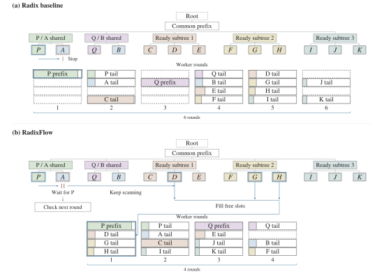
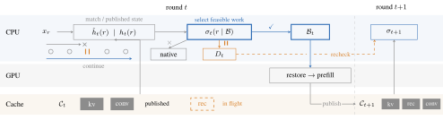
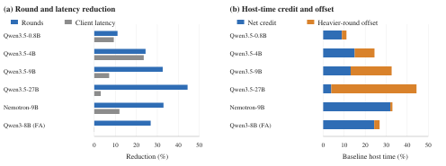
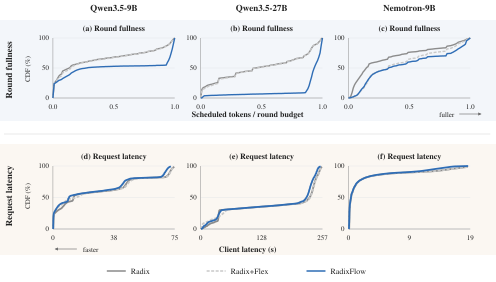

# RadixFlow: Filling Execution Bubbles in Prefix-Cached Hybrid LLM Serving

> 原文：[abs](https://arxiv.org/abs/2610.18143) · [PDF](https://arxiv.org/pdf/2610.18143)

> HKUST 出品，已集成进 vLLM。混合架构（linear attention + full attention 交错）的 prefix cache 有个隐藏陷阱：命中了缓存也未必能跑。RadixFlow 只改调度器扫描规则——堵在队首的消费者只堵自己、不堵整条队列——五个混合模型平均延迟降 3-24%。

## 背景与动机

RAG、多轮对话、agent 流水线让线上推理进入 prefill 为主的模式，大家都靠 prefix caching 续命。但现有调度器默认一个前提：**前缀命中 = 可以执行**。全注意力模型确实如此——命中的前缀只需要 KV page。混合架构（Qwen3.5、Nemotron 这类 Mamba2/linear + full attention 混血）打破了这个前提：恢复一个分支除了 KV 还需要在匹配边界处的 recurrent/convolutional 状态，而这些状态可能正被同轮的另一个分支计算着。

打个比方：食堂窗口（worker round）前排队，A 同学（consumer）的饭卡里的钱要等 P 同学（producer）先充值到共享账户。现在的调度器扫到 A 发现「暂时不行」就**停止整条扫描**——后面明明有 D 同学（独立分支）证件齐全能打饭，也一并被晾着。论文管这些本可合法填上的空位叫 execution bubble：示例负载里同样 12,970 个 token，prefix-stop 规则要 6 轮、留 9 个空位；继续扫描只要 4 轮、留 1 个空位。

这个 head-of-line blocking 在 vLLM 现有代码路径里真实存在：hybrid-state manager 的分配失败直接终止等待队列扫描（Appendix F.1 定位了源码路径）。

## 方法

### 状态就绪遍历（state-ready traversal）

核心改动小得惊人：把「全局扫描屏障」变成「局部等待」。按原生顺序扫描到达的分支，每个分支过原生 state check 得到三种结果：

- **Ready**：加入本轮 batch，走原生分配器。
- **Blocked**（消费者，同轮依赖）：进等待队列 `D_t` 保持注册，**继续扫描后面的分支**；下一轮再唤醒重查。
- **Other**（预算不够等其它失败）：保持原生处理（可能停止）。

只堵消费者一个人，不堵队列。论文证明了固定轮次下 RadixFlow 选出的 batch 是 prefix-stop 的超集；若 readiness 随 batch 增长单调且无 Other 中断，可避免的 bubble 全部消除。代价是线性于被检查分支数的额外队列访问。

### 灵活准入（flexible admission）

扫描前先短暂攒一会儿到达的工作（deadline 5ms，约为 Qwen3.5-0.8B 原生平均 worker 调用间隔 52.95ms 的 9%）。三种情况提前放行：worker 已有活干、攒的分支填满可用行、或剩余 token 需求填满 token 预算。分支不必等它所属请求组的其他兄弟。

### 碎片防护（Frag，消融项）

剩余预算太小会把分支切成额外碎片；RadixFlow+Frag 在切分会缩短下一对齐段时推迟该分支、另找合适的。主方法不带这个。

### 关键图表

**图 1：execution bubble 机制对比**（prefix-stop vs 继续扫描，同 12,970 token：6 轮 9 空位 vs 4 轮 1 空位）

> A 等 P 时，baseline 把 D 也挡在门外；RadixFlow 只挂起 A。蓝色描边是首轮选择，虚线格是空位，阴影长度是 token 负载。[arXiv 原图](https://arxiv.org/html/2610.18143v1#S1.F1)

**图 2：架构——改选择不改存储**

> 前缀查找与原生 state check 不动，RadixFlow 只改「哪些分支进本轮」的选择：✓ 选中、pause 进等待队列、× 走原生处理。缓存存储与状态发布策略完全复用。[arXiv 原图](https://arxiv.org/html/2610.18143v1#S4.F2)

**图 3：轮次节省与延迟收益的换算**

> 左：相对 Radix 的轮次缩减；右：轮次信用（省下的调用）与剩余轮次成本上移的分解——省的轮次不等于省的时间，27B 上每千 token 主机成本 183→175ms，9B 上成本上移吞掉约 60% 轮次信用。[arXiv 原图](https://arxiv.org/html/2610.18143v1#S5.F3)

**图 4：轮次更满 + 请求更快**

> (a)-(c) 轮次朝满预算方向移动；(d)-(f) 请求延迟分布，收益因模型而异。[arXiv 原图](https://arxiv.org/html/2610.18143v1#S5.F4)

**Table 1（转 markdown，节选）**：

| 模型 | Radix 延迟(s) | RadixFlow 延迟(s) | 轮次 K | 复用率(%) |
|---|---|---|---|---|
| Qwen3.5-0.8B | 0.256 | **0.232** | 19803→17610 | 81.36→81.37 |
| Qwen3.5-4B | 13.1 | **10.0** | 13424→10146 | 80.41→80.43 |
| Qwen3.5-9B | 26.7 | **24.8** | 11042→7444 | 79.69→79.70 |
| Qwen3.5-27B | 164 | **159** | 11748→6529 | 68.50→68.51 |
| Nemotron-9B | 2.44 | **2.15** | 14338→9613 | 75.94→75.95 |
| Qwen3-8B (全注意力对照) | 16.4 | 16.4 | 9223→6746 | 85.24→85.25 |

> 复用率几乎不动（±0.03pp）——纯调度收益，白拿。27B 轮次砍近半（11748→6529）但延迟只降 3%：更满的轮本身更贵。全注意力对照上轮次也降了（9223→6746）但延迟纹丝不动——证明收益确实来自混合架构的依赖处理，而非单纯攒批。

## 实验

- **设置**：vLLM 0.29、A800、eager 模式；负载为 QuALITY+RACE 阅读理解构造的多分支打分型请求（1034+517 题、每题 4 分支、每分支 1 token 输出，模拟多候选评分/judging 的 prefill 模式）；冷/混/复用三种流 × 两种顺序，每策略 9306 个逻辑请求。行/Token 预算按 vLLM 自动调参在 64 题held-out 上调一次后冻结。
- **延迟**：五个混合模型平均延迟 -9.3% / -23.6% / -7.1% / -3.1%（Qwen3.5 0.8B→27B）、-12.0%（Nemotron-9B）。
- **轮次**：-11% 到 -44%。27B 上 Flex 准入只省 1.6% 轮次，遍历省 44%——大头是遍历不是准入。Nemotron 反过来（准入 27% + 遍历 8%）：它原生每轮只坐 2.91/16 行，低负载下攒批收益更大。
- **批密度**：每轮行数 0.8B 3.63→4.10、27B 6.51→12.11（+86%）。
- **尾延迟**：9B p95 73.3→70.6s；全注意力对照尾部不变。
- **首选延迟**（注册到被选中）：27B 160.5→153.3s（-4.5%），小模型 -14~17%。

## 复现要点

- **代码**：已集成进 vllm-jev（论文语）；摘要未给独立 repo 链接，可从 vLLM 生态跟进
- **模型**：Qwen3.5-0.8B/4B/9B/27B（hybrid）、NVIDIA-Nemotron-Nano-9B-v2（Mamba2 hybrid）、Qwen3-8B（全注意力对照）
- **负载**：QuALITY（62 篇文章 1034 题）+ RACE-M（128 篇 517 题），每题 4 分支
- **关键参数**：准入 deadline 5ms；S/T 预算冻结（0.8B S=16、4B/9B/27B S=64、T=8192）；offered 5 req/s（27B 过载态）
- **最小复现路径**：vLLM 0.29 + hybrid 模型 + 多分支共享文档负载 → 对比 prefix-stop 与继续扫描的轮次计数和空行数
- **注意**：27B 的 5 req/s 超过其 ~0.74 req/s 的排水能力（持续过载 + 发送端背压），延迟数字要在过载语境下读；每配置只跑一次，小效应（3%）无重复实验不确定性

## 启发与局限

- 「缓存命中 ≠ 可执行」这个观察对混合架构时代是通用的：凡是带 recurrent state 的架构（Mamba、RWKV、 hybrids），prefix 复用都要过「状态就绪」这一关。radix tree 索引只回答「有没有」，不回答「能不能用」。
- 修法极简（继续扫而不停）且有超集证明，这类「识别被默认假设掩盖的调度浪费」的题目思路值得抄：找一个 everyone takes for granted 的前提，构造反例，然后最小改动。
- 全注意力对照的设计很干净：轮次同样下降但延迟不动，把「轮次节省」和「延迟收益」解耦，避免被无关收益污染归因。
- 局限：收益换算损耗明显（27B 轮次 -44% 但延迟只 -3%，轮更贵）；单次运行无方差；负载是合成的多分支打分型（每分支只出 1 个 token，decode 极少），真实 agent 混合负载下 bubble 占比可能不同。

## 疑问清单

1. Blocked 消费者下一轮唤醒重查，如果 producer 跨多轮仍未完成（超长 prefill），等待队列会不会堆积放大尾延迟？论文只展示了 p95 小幅改善。
2. 准入 deadline 5ms 是按 0.8B 的调用间隔定的，27B 一轮就上百 ms——「一刀切 5ms」在大模型上是否过于保守？
3. 异步调度（async scheduling）关闭下测的；开启后 CPU 控制与 GPU 重叠，bubble 形态和收益会不会变？（Appendix 提到 async 依赖需要按 producer 代际 + completion fence 识别，作者自己也标注了这是独立实验。）

## 新学到的术语

- **Execution Bubble**（learning）：调度中本可被合法工作填上的空闲批位；混合架构下 head-of-line blocking 的产物
- **Hybrid LLM**（learning）：linear attention（Mamba2 等）与 full attention 交错的架构（Qwen3.5/Nemotron v2），KV cache 外还有 recurrent state 需要 prefix 复用时同步
- **State-ready Traversal**（learning）：扫描等待队列时只阻塞同轮依赖的消费者、继续检查后续就绪分支的调度规则
