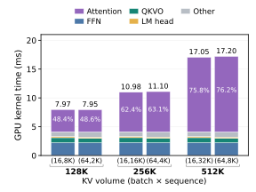
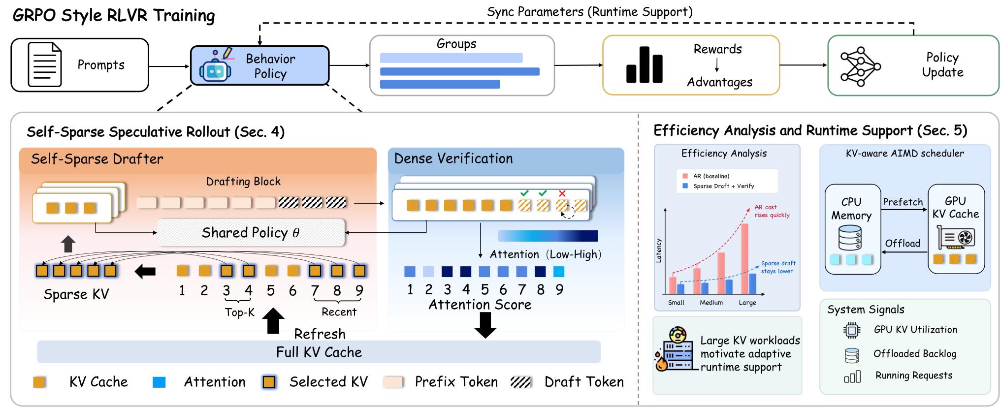
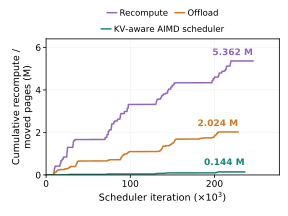
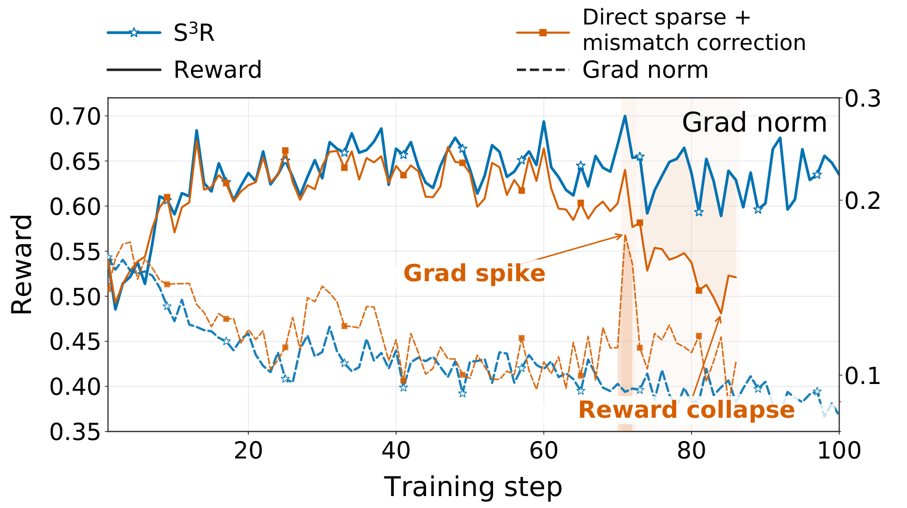

# S³R: Fast and Faithful RL Rollouts via Self-Sparse Speculative Decoding

> 原文：[abs](https://arxiv.org/abs/2610.13202) · [PDF](https://arxiv.org/pdf/2610.13202)

> HKUST(广州) 出品。RL 训练里 rollout 生成占大头，注意力读 KV cache 占解码 kernel 时间的 72-76%。直接上 sparse attention 采样会让训练崩掉——而且论文证明了「事后加 importance reweighting 修正」在 GRPO 下根本修不回来。S³R 的答案是让稀疏只负责起草、稠密验证负责把关：投机解码的精确采样保证 response group 分布与稠密策略完全一致，训练侧零修正。端到端训练吞吐 1.39×/1.35×。

## 背景与动机

RLVR（可验证奖励的 RL，数学/代码题用规则验证器打分）训练里，GRPO 这类组相对算法每题采 G 条回答、组内比出 advantage。长回答的自回归生成让 rollout 成了训练流水线的主要开销——profile 显示注意力（每步读越来越长的 KV cache）占解码 kernel 时间的 **72-76%**。

显然的加速思路是 sparse attention：少读点 KV。但直接拿来采样就出事了——采样分布变了，行为策略（behavior policy）和被优化策略不一致。已有工作用训练侧修正（filtering + importance reweighting）补救。论文的关键理论贡献（Proposition 1）是泼了盆冷水：**在 GRPO 下，即使每条 response 用精确的似然比 `W_i = P(o^i)/Q_s(o^i)` 重加权，也一般恢复不出稠密策略的期望更新**。原因是组耦合：一条 response 的 advantage 取决于组内其他成员的 reward，而其他成员也是从稀疏分布采出来的——你修正了自己这条的「出场概率」，修不了「组内比较格局」被稀疏采样扭曲的部分。

打个比方：裁判（advantage）是按小组内相对排名打分的，稀疏采样不仅改变了谁上场，还改变了同组对手的实力分布——给某个选手按出场概率加权，弥补不了整个小组赛局的变化。

## 方法

### 核心思路：稀疏起草 + 稠密验证，把稀疏关进投机解码的笼子

投机解码（speculative decoding，实习生起草、老板一次审批多个 token，数学上不损失目标分布）天然提供了「计算省但分布不变」的机制。S³R 把它搬到 RL rollout：

- **起草（drafter）**：同一个策略权重、只看稀疏 KV 视图（预算 s=0.05，即每层只保留 5% 历史 KV）。每块起草前用上一轮验证的 attention 分数 Top-K 选出保留集合 `I_ℓ`（保留近期局部 `R_ℓ` + 按验证分数选远处），k=6 步自回归起草，记录完整提议分布。
- **验证（verifier）**：一次 full-attention 前向并行验证整块草稿，在**稠密历史 KV** 上重算（不能复用近似状态），按标准精确投机采样逐 token 接受（`min{1, p/q}`），首个拒绝处丢弃后缀、从残差分布 `r_s` 采修正 token。验证后的 attention 分数平均，作为下一块稀疏选择的依据。

Proposition 2 证明：任何稀疏预算 s 下，产出的 response group 分布严格等于稠密自回归分布——**分布不变性把 s 变成纯效率旋钮**，可以放心往激进调（s=0.05）而不用担心改变学习信号。

与三类已有 drafter 方案对比的差异化：N-gram/历史检索依赖复现性（温度 1.0 的 RL 探索下不够用）；辅助 drafter（EAGLE3 等）在策略不断更新时迅速过期、维护成本高；S³R 起草和验证**共享同一份冻结快照 `θ_old`**，策略更新后自然同步，零 drafter 训练。

### 运行时：KV-aware AIMD 调度

稠密验证仍需完整历史 KV。长回答累积下 GPU 显存吃紧，反复 offload/restore 会抖动（thrashing）。S³R 用 AIMD（加性增、乘性减）动态调节并发上限：GPU KV 利用率低就加并发，高利用或恢复积压过多就乘性回退；暂停的请求优先恢复、保留 token/提议状态，同一冻结快照下跑完全部 G 条组内回答（Proposition 2 的完整组条件）。RL 步之间释放状态、同步新权重、重建推理态。

### 关键图表

**图 1(a)：注意力主导 AR 解码**

> KV 体量增长下注意力占解码 kernel 时间 72-76%——这是 sparse 起草的收益来源。[arXiv 原图](https://arxiv.org/html/2610.13202v1#S1.F1)

**图 2：方法总览**

> 稀疏起草（共享策略权重 + 稀疏 KV 视图）→ 稠密验证（full attention + 精确投机采样）→ KV-aware 运行时支撑；同一冻结快照 θ_old 下完成整组回答。[arXiv 原图](https://arxiv.org/html/2610.13202v1#S4.F2)

**图 1(c)：KV-aware 调度器效果**

> 累计 KV 页重算/传输量：AIMD 调度大幅减少重复 KV 重建与搬运（offload episodes 1097→59，每千 token 搬运页数 18.0→1.3）。[arXiv 原图](https://arxiv.org/html/2610.13202v1#S1.F1)

**图 4：稳定性——直接稀疏 vs 训练侧修正 vs S³R**

> (a) s=0.05 下「直接稀疏 + 重加权修正」早期 reward 接近但梯度范数波动更大，~70 步处尖峰后崩塌；S³R 全程稳定。(b) 无修正直接稀疏：s=0.05/0.7/0.8 都崩，只有 s=0.9 勉强稳——稀疏激进度受稳定性约束；S³R 在 s=0.05 贴着稠密轨迹走。[arXiv 原图](https://arxiv.org/html/2610.13202v1#S6.F4)

**Table 1（转 markdown）：主结果**

| 模型 | 方法 | AIME26 | ArXiv-Math | τ(块效率) | Rollout 时间 | 端到端吞吐 |
|---|---|---|---|---|---|---|
| Qwen3-1.7B | AR | 37.2 | 9.95 | — | 10.5min | 1.00× |
| | N-gram | 37.1 | 9.84 | 1.31 | +19.1% | 0.72× |
| | History Retr. | 36.0 | 9.77 | 2.03 | -1.7% | 1.05× |
| | EAGLE3 冻结 | 36.7 | 9.87 | 1.89 | -13.9% | 1.11× |
| | **S³R** | 37.1 | 9.89 | **5.59** | **-38.6%** | **1.39×** |
| Qwen3-8B | AR | 65.42 | 15.70 | — | 36.1min | 1.00× |
| | **S³R** | 65.42 | 16.28 | **5.47** | **-33.2%** | **1.35×** |

> τ≈5.5（k=6 下平均每轮接受 5.5 个 token）碾压基线的 1.3-2.0；质量分数与 AR 打平。

## 实验

- **设置**：Qwen3-1.7B/8B + DAPO-MATH-17k，DAPO 变体 GRPO，batch 256 prompt × 8 response，温度 1.0，最大回答 16K/24K token；veRL 框架，单机 8×H100；S³R 用 k=6、s=0.05、KV-aware AIMD。
- **吞吐**：端到端训练吞吐 1.39×（1.7B）/ 1.35×（8B）；rollout 时间 -38.6%/-33.2%。块效率 τ≈5.5，中位接受率 78.2%，每 token 生成时间 0.0630ms（评估方法中最低）。
- **稳定性**：直接稀疏 + 精确重加权修正（matched 消融）在 s=0.05 下 ~70 步梯度尖峰后崩塌；无修正版本 s≤0.8 全崩；S³R 贴着稠密轨迹。
- **预算权衡**：s 从 0.05→0.50，接受率 80.4%→96.7% 但加速从 1.37×→1.06×（多读的 KV 比多接受的 token 更贵）；s=0.03 两头都降。0.05 是甜点。
- **KV 调度**：AIMD 相比固定并发 offload-256 再 +5.8%，相比 AR 生成吞吐 +59.5%；CPU KV 峰值占用 52464→21358 页，reoffload 5%→0%。
- **漂移**：训练全程 S³R 接受率相对降 5%，冻结 EAGLE3 降更多且随策略熵上升持续恶化。

## 复现要点

- **代码**：论文未附 repo 链接（关注作者后续；veRL 生态）
- **框架**：veRL（Sheng et al. 2025），单机 8×H100
- **算法**：DAPO 变体 GRPO；k=6、s=0.05；稀疏选择 = 近期局部 + 验证 attention 分数 TopK（式 4）
- **数据**：DAPO-MATH-17k；评测 AIME26 + ArXiv-Math pass@1
- **基线复现**：N-gram lookup（prompt lookup decoding）、RhymeRL 式历史检索、冻结 EAGLE3(k=5)
- **最小复现路径**：veRL + Qwen3-1.7B + DAPO-MATH 少量步数，对比 AR 与 S³R 的 rollout 时间和 reward 轨迹稳定性
- **注意**：加速依赖「注意力主导」前提（长上下文数学推理）；短上下文负载下起草+验证开销可能吃掉收益（图 3 显示 B=16/S=4K 处 break-even τ≈3.8）

## 启发与局限

- **「把近似塞进提议、把精确留给验证」是处理 train-infer mismatch 的通用范式**。昨天精读的 LLM RL 综述里 TIS 用 importance ratio 修引擎概率差（事后修），S³R 用精确投机采样保证分布不变（事前保）——后者更彻底：修正项直接从训练管线里消失。任何「想用便宜计算又怕改变训练分布」的场景（低精度 rollout、early-exit）都可以套这个问法。
- Proposition 1 的组耦合论证对 GRPO 家族（DAPO/Dr.GRPO 等组相对 advantage）全部适用——这类算法对 behavior policy 偏差比 REINFORCE/PPO 更敏感，选 rollout 加速方法时要格外小心。
- KV-aware AIMD 是 serving 里 CC 拥塞控制思想搬到 RL rollout 并发管理的又一例（与 RadixFlow 同一天读，都是「调度细节决定系统收益」）。
- 局限：稀疏起草每块要重选 TopK（用上轮验证分数），块间有依赖串行；稠密验证保留全量 KV，显存压力只是被调度缓解而非消除；与 EfficientRollout（量化自起草）的对比是 related work 定位而非实测；MoE/线性注意力模型未覆盖（作者列为 future work）。

## 疑问清单

1. s=0.05 的甜点会随任务类型漂移吗？数学推理 attention 集中度高，换成代码（attention 更分散）TopK 选 5% 还够吗？论文只在 DAPO-MATH 上调的。
2. 起草用上一轮验证的 attention 分数选 KV——验证只算被接受前缀的分数，被拒 token 位置的信息浪费了；用 drafter 自己的分数在线更新会不会更准？
3. 8×H100 单机的 AIMD 结论在多机 rollout 集群（CPU offload 池共享）下还成立吗？并发调节的信号（GPU 利用率/恢复积压）跨节点怎么聚合？

## 新学到的术语

- **Self-Speculative Decoding**（learning）：用目标模型自身的变体（跳层/稀疏注意力/量化）做 drafter 的投机解码，免训练独立小模型
- **Behavior Policy Mismatch**（learning）：RL 中采样策略与被优化策略不一致（稀疏/低精度/过期 drafter 都会引起），GRPO 类组相对算法对此尤其敏感
- **Block Efficiency (τ)**（learning）：投机解码每轮平均产出 token 数（含修正/bonus token），决定验证成本能否被摊薄
- **AIMD 调度**（learning）：加性增、乘性减的并发/速率控制（TCP 拥塞控制同款），此处用于 RL rollout 的 KV 显存压力自适应
