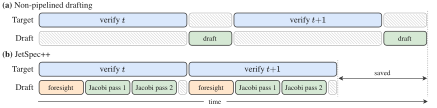
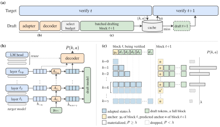
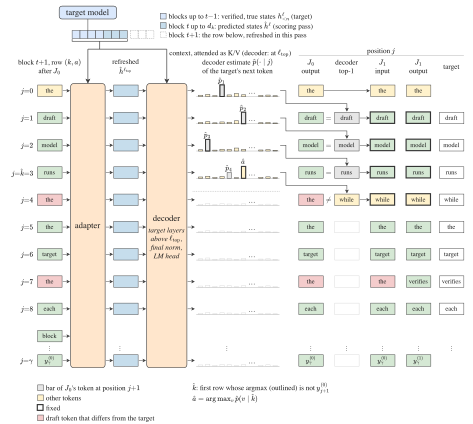

# JetSpec++：先见之明起草 + 自我精修，把起草成本赶出关键路径

> 原文：[abs](https://arxiv.org/abs/2610.19792) · [PDF](https://arxiv.org/pdf/2610.19792) · 代码：[hao-ai-lab/JetSpec](https://github.com/hao-ai-lab/JetSpec)

> UCSD + UIUC + StepFun 出品。投机解码的两个命门：接受率和起草成本。JetSpec++ 的赌注是把后者压到接近零：大模型还在验证第 t 块时，小模型已经在另一张 GPU 上猜「验证结果可能是哪几种」，提前把第 t+1 块的草稿写好。验证一返回，命中缓存直接用，草稿时间从每轮 3.8ms 藏到 0.66ms。GB200 上单请求 1361 tok/s，比 AR 快 7.45×，比 DSpark 快 1.54×，输出分布严格不变。

## 背景与动机

投机解码（实习生起草、老板一次审批多个 token）的每轮延迟 = (T_draft + T_verify)/τ。2026 年的 parallel drafting（DFlash/DSpark/Domino 一族）已把 T_draft 压到几乎与块长无关，但仍串行地挡在关键路径上。

自然的下一步是流水线化：验证第 t 块的同时起草第 t+1 块。但对「读目标模型 hidden state」的现代 drafter，这有个鸡生蛋问题——起草 t+1 块需要知道两样只有验证结束才有的信息：**接受了几个 token（k）和 bonus token（下一块的锚点 a）**，以及**新验证上下文的目标 hidden state**。等验证结束再起草，流水线就没了。

已有方案各有残缺：SSD 用独立 AR 小模型可以提前起草（不受目标状态依赖拖累），但 AR 起草太慢反而超出验证窗口 8.5ms；DPara 为每个可能的 k 预算 backbone 前向，但读不到目标状态只能裸奔；SpecBranch/SwiftSpec 走多分支对冲，成本随分支数涨。

## 方法

三件套，分别解决「不知道验证结果」「不知道目标状态」「起草闲着也是闲着」：

### 1. Foresight Drafting：预测「世界线」

不等验证结果，先押注多种可能结局。每个 request 增加两个轻量模块：

- **hidden-to-hidden adapter**：一层层往上预测目标模型在当前块各位置的 hidden state（读已验证前缀的缓存状态 + 自己下层预测，12 层小 transformer，从目标权重复制初始化）。相当于目标模型的「低配替身」——真模型还在算，替身已经把它的内部状态猜了个八九不离十（恢复真状态 95% 的差距）。
- **decoder**：复用目标模型最后几层冻结权重 + LM head，从 adapter 的预测状态一步算出所有可能结局的分布 P(k, a)——接受 k 个 token 且 bonus 是 a 的概率，一次前向把整张结局矩阵算完（位置 j 同时服务 d_{j+1} 的接受概率和 k=j 时的 bonus 分布）。

按 P(k,a) 选概率最高的 B=16 个结局（split-conformal 校准阈值过滤），每个结局预写一块完整草稿放进 speculation cache。验证返回后看真实 (k,a) 是否命中：命中直接用（92.9% 命中率），未命中退回普通投机步骤。**无论预测多离谱，验证侧的拒绝采样保证输出分布严格不变**——预测只影响速度，不影响正确性。

### 2. Jacobi 式自我精修：把气泡填满

流水线化后草稿侧有了整个验证窗口的空闲算力（8B 验证 6.2ms，起草其实只要 2ms 左右）。JetSpec++ 用它跑 Jacobi 迭代：draft model（JetSpec 架构，块内 causal attention）把自己的草稿当代码块输入，每个位置基于前面位置的草稿 token 重新预测，多轮迭代让「每个位置独立预测」逐步逼近「逐 token 因果分解」。并行预测的通病是 prefix-blind——上下文允许「of course」和「no problem」时会拼出「of problem」，Jacobi 迭代让位置 i 看到前面真实草稿后再改口。

### 3. Context Refresh + Anchor Replacement：中途模拟验证

纯 Jacobi 迭代收益递减。两个 pass 之间，用 adapter+decoder 对当前草稿模拟一次「假验证」：adapter 重预测草稿的目标状态，decoder 找到第一个与自己预测不符的位置，把该位置直接替换成 decoder 的 token 并固定，下一轮只重写其后的位置。消融显示 anchor replacement 是增益大头（贡献 context refresh 联合增益的 66% 以上）——早定位早改口，后面少陪跑。

训练上配套一招：不只用全噪声块训练，而是「干净前缀 + 噪声后缀」（Jacobi forcing 式），让模型学会修复任何收敛阶段的块。全噪声训练的模型 J0 起草一样好但完全不会精修（τ 卡在 4.37 不动）；token 输入（而非 mask embedding）+ 干净前缀调度才有精修能力（4.34→5.05）。损失用 forward KL（比 SFT/reverse KL 最多高 2.72 token）。

### 关键图表

**图 1：非流水线 vs JetSpec++**

> (a) 传统 drafter 等验证完才能起草；(b) JetSpec++ 在块 t 验证期间跑 foresight + Jacobi pass，起草完全藏进验证窗口。[arXiv 原图](https://arxiv.org/html/2610.19792v1/F1)

**图 2：Foresight Drafting 数据流**

> (a) 选中的结局集合 S 一批 J+1 pass 起草；(b) adapter 逐层预测目标 hidden state，decoder 算结局分布 P(k,a)；(c) speculation cache 结构：结局 k 的草稿 + 适配状态 + 锚点 token a。[arXiv 原图](https://arxiv.org/html/2610.19792v1/F2)

**附录图 R1：Context Refresh + Anchor Replacement**

> 两个 Jacobi pass 之间：adapter 重预测草稿状态 → decoder 定位第一个分歧位置 → 写入 â 并固定 → 下一 pass 只改其后位置。[arXiv 原图](https://arxiv.org/html/2610.19792v1)

**Table 3 核心数字（GB200, budget 16, temp 0）**

| 目标 | 方法 | tok/s（加速比） | τ | 每轮暴露的起草时间 |
|---|---|---|---|---|
| Qwen3-8B GSM8K | DSpark | 744.3（4.08×） | 7.34 | 3.76 ms |
| | JetSpec++ | 1148.8（6.30×） | 7.78 | 0.61 ms |
| Qwen3-8B MATH | DSpark | 902.1（4.94×） | 8.98 | 3.80 ms |
| | JetSpec++ | 1361.1（7.45×） | 9.41 | 0.66 ms |
| Qwen3.8-27B MATH | DSpark | 279.8（4.72×） | 8.99 | 4.52 ms |
| | JetSpec++ | 367.2（6.20×） | 10.45 | 0.77 ms |

## 实验

- **接受长度 τ**（Qwen3-8B, temp 0, budget 16）：J3-R3 平均 8.94 vs DSpark 6.89，七个基准全面领先；budget 32 时 JetSpec++ τ 继续涨（11.45 MATH-500）而 DSpark/DFLash/Domino 反而跌（causal 块内注意力外推友好）。
- **泛化**：Qwen3.8-27B（48/64 层 Gated DeltaNet 的 hybrid 模型）上 adapter/decoder 适配 hybrid 层后同样全面领先（12 层 adapter 不随目标规模膨胀）。
- **系统**：8B 上 1.54×/1.51× 于 DSpark；27B 上 1.37×/1.31×。目标越大验证窗口越长（27.4ms），塞得下 3 个精修 pass，收益结构自动升级。
- **架构对比**：SSD 因 AR 起草超窗 8.5ms 只有 1.5×——流水线的前提是起草侧足够并行。

## 复现要点

- 代码开源：`github.com/hao-ai-lab/JetSpec`。draft model 基于 JetSpec 架构（块内 causal），训练数据是目标模型重生成的 800k 序列，block size 16。
- 关键训练配方：token 输入（非 mask）+ 干净前缀调度（前缀长度 m 按固定 schedule 采样）+ forward KL。三者缺一精修能力大打折扣（Table 4 消融：mask+全噪声 = τ 从 1.23 到 5.99 全线崩）。
- 部署形态：目标 + 起草两张 GPU，CUDA graph 捕获，进程间通信 T_comm。单请求延迟导向（batch=1）；batch 场景验证窗口变长，foresight 预算更充裕但显存压力上升。

## 启发与局限

- 「预测验证结果 + 多世界线对冲」把 lossless 验证和激进流水线解耦了——预测错了只是慢一点（退回 fallback），永远不会错。这个「预测只影响速度」的设计模式和 S³R 的「稀疏只起草、稠密把关」、KV4-RL 的「INT4 为主、INT8 保底」是同一哲学：**近似放在提案侧，精确放在验证侧**。
- 与昨天 DLoop 一脉相承的观察：draft model 的空闲算力是免费资源，Jacobi 精修、多结局对冲都在「花计算买接受率」。GB200 级硬件上这个趋势只会更明显。
- 局限：batch=1 单请求延迟场景，多租户 batch serving 下 speculation cache 的 B=16 结局 × batch 维度的显存和调度开销未评估；两卡配置对小模型可能不划算（8B 的 6.3× 里含第二卡的贡献，单卡数字未报）；依赖目标 hidden state 的 adapter 每换一个目标都要重训。

## 疑问清单

- speculation cache 命中率 92.9%，剩下 7% 的 miss 轮 τ 只有 3.45-4.87——miss 的长尾在什么分布的 prompt 上集中？写作类（MT-Bench τ 只有 5.29）是否就是 miss 重灾区？
- adapter 预测的是「目标在草稿块上的 hidden state」，但 RL rollout 场景下目标策略每个 iteration 都在变，adapter 的过期速度和重训成本如何？（对比 S³R 直接共享策略权重零维护。）
- budget 32 时 τ 11.45 但验证算力翻倍，端到端最优 budget 是否随目标规模移动？论文只测了 16/32 两点。

## 新学到的术语

- **Foresight Drafting**（learning）：验证未结束时预测目标 hidden state 和验证结局分布，提前起草下一块，使起草脱离关键路径
- **Jacobi 迭代起草**（learning）：把草稿块当输入反复前向，每轮用前面位置的结果修正后面位置，逼近逐 token 因果分解
- **Speculation Cache**（learning）：按预测结局 (接受数 k, bonus a) 索引的预起草块缓存，验证返回后查表命中即免起草
- **Prefix-blind**（learning）：并行预测各位置互看不到对方选的 token，可能拼出上下文不允许的组合（如「of problem」）
