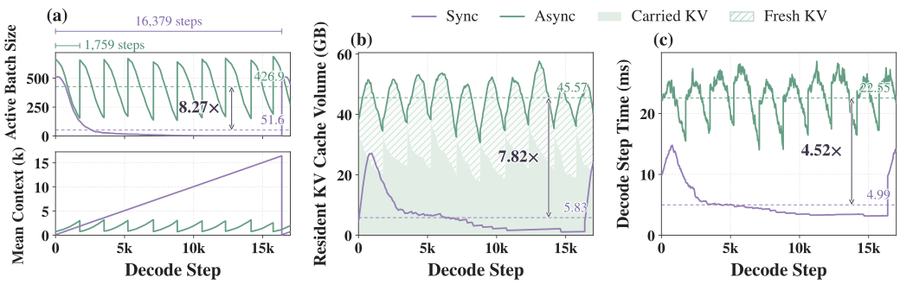
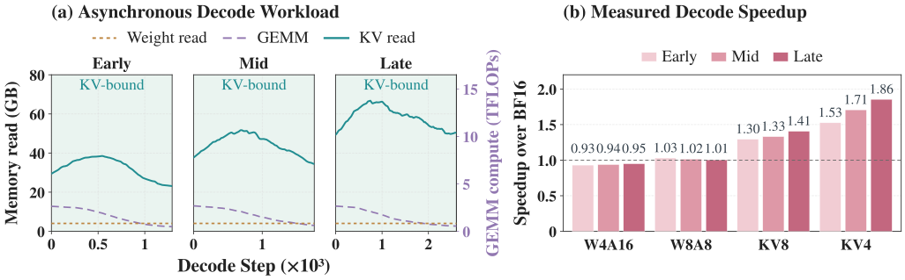
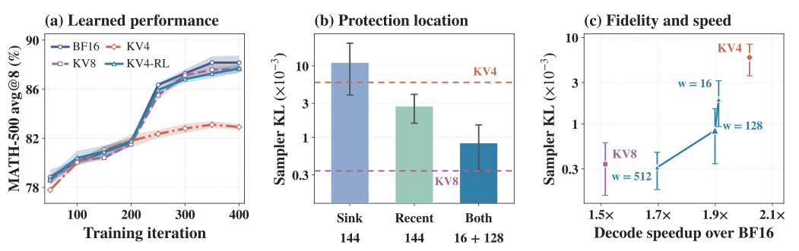
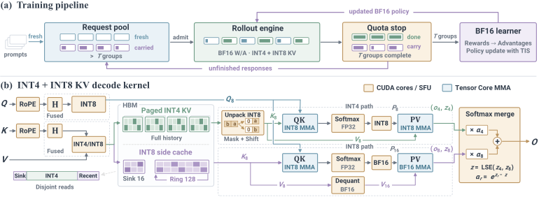

# KV4-RL：INT4 KV cache 量化加速 RL rollout

> 原文：[abs](https://arxiv.org/abs/2610.14448) · [PDF](https://arxiv.org/pdf/2610.14448)

> KAIST + NAVER Cloud 出品，S³R（昨天笔记）的续篇视角：同样瞄准 RL rollout 加速，S³R 省的是「读多少 KV」（稀疏起草），KV4-RL 省的是「每个 KV 存多少字节」（INT4 量化）。核心发现是个系统性洞察：异步 rollout 把生成长尾填平后，瓶颈结构性地转移到了 KV cache——这时量化 KV 比量化权重/激活加速大得多。但裸 INT4 会让策略学坏（MATH-500 掉 5.24 分），解法是只给开头的 attention sink 和最近的 128 个位置上 INT8「保险」。rollout 累计提速 1.80×，最终六基准均值与 BF16 训练差距 <0.5 分。

## 背景与动机

RLVR 训练里 rollout 生成是大头，业界的解法是异步 rollout：不等一批全生成完，谁先结束谁退出、立刻放新请求进来，GPU 不空转。但论文指出这带来一个被忽视的副作用——**KV concentration**。

直觉：食堂窗口（decode step）本来一拨人吃完才换下一拨（同步），现在改成有人吃完马上补位（异步）。窗口确实不空转了，但每一时刻窗口前排队的「盘子总量」（每步要处理的 KV 上下文）暴涨——长回答的人一直占着座位，而且越到训练后期回答越长，这个效应越强。论文给了个漂亮的概率论证（Proposition 4.1）：浓度因子 C_KV = E[max]/E[L] ≥ 1，只要回答长度分布有方差就严格大于 1，且并发数 B 越大浓度越高——这不是工程实现的偶然，是异步调度的结构性后果（长回答活跃步数多、在活动 batch 中被过度代表，即 inspection paradox）。

实测 Qwen3-4B 轨迹：异步让平均常驻 KV 体量 ×7.82、单步 decode 延迟 ×4.52。吞吐仍高 1.83×，但到 8B 后期，高单步成本 + 固定页预算把异步 decode 吞吐拖到 0.98×——并发红利被 KV 成本吃光了。

## 方法

### 第一步：想清楚量化谁——KV concentration 改变了答案

并发大了之后，权重读取被 batch 摊薄，attention 却仍要处理每条 response 的全部上下文。roofline 分析显示 KV 读取是异步 rollout 最大的一项理想服务需求，且随回答变长持续增长；权重流量和 GEMM 工作量基本不变。

匹配工作负载对比（同一 decode 状态回放，隔离数值执行差异）：KV4 前向加速 1.53–1.97×（随训练后期上下文变长而增大），KV8 1.30–1.41×；而 W4A16（vLLM Machete）和 W8A8（FP8）基本贴着 BF16 或更慢。**结论：在异步 rollout 这个 regime 里，KV 量化 > 权重量化 > 权重+激活量化。**量化 KV 还有第二重收益：同样 HBM 预算能塞更多常驻上下文，并发上限更高。

### 第二步：INT4 会学坏——TIS 修不全

KV cache 像做数学题的草稿纸，INT4 量化相当于把草稿纸压缩成缩略版。对普通推理，缩略草稿只影响单条输出质量；但 RL rollout 的输出是训练数据，误差会沿轨迹累积、改变采样前缀和组内 advantage，最终改变学到的策略。

裸 INT4 rollout（带 TIS 截断重要性采样修正）在 Qwen3-8B GRPO 上：早期贴着 BF16，后期跟不上，MATH-500 avg@8 低 5.24 分。KV8 则全程贴住 BF16——说明 INT8 精度够用，但全 cache 用 INT8 又牺牲了 INT4 的大半速度。

### 第三步：有界选择性保护——sink + recent 上 INT8 保险

KV4-RL 的设计：全上下文存 paged INT4，另外维护一个固定容量的 INT8 边车缓存，只保护两类敏感位置——

- **attention sink**（开头 s=16 个位置：模型对开头 token 有异常高的注意力权重）
- **recent context**（最近 w=128 个位置：即将参与下一步生成的近期上下文）

保护开销与上下文长度无关（s+w 有界），不像细化量化组或误差补偿那样「每个 token 都要付税」。固定 144 位置预算下，16 sink + 128 recent 的组合把共享前缀条件 KL 相对裸 KV4 降 7.0×，且优于全给 sink 或全给 recent——两类保护互补而非可互换。

执行层两条独立数值路径并行跑再精确合并：主路径 INT4（整数 QK/PV，查询旋转后量化成 INT8）；保护路径 INT8 存储但 value 反量化成 BF16 做 PV（FP32 累加）；各自算出区域 attention 输出和 log-normalizer，用精确 softmax merge 合并。位置滑出 recent 窗口时 INT4 主缓存里已有它，边车槽位直接复用，零搬运零重量化。

实现细节：每 128 维 token-head 向量一个 affine INT4 组（scale/offset 存 FP16，头内共享参数使 scale/offset 可以在点积归约后统一施加），存储开销 4.25 bit/元素；key 在 RoPE 后过固定 Hadamard 旋转（打散离群值再量化，query 同旋转，正交变换不改变 QK 分数），calibration-free——量化参数对每个新生成的 KV 向量在线计算，天然跟上不断更新的策略。

### 关键图表

**图 2：KV concentration 实测**

> Qwen3-4B 中期 checkpoint 的同步 vs 异步轨迹：(a) 异步维持 8.27× 更大活动 batch；(b) 平均常驻 KV 体量 ×7.82；(c) 单步 decode 延迟 ×4.52。异步填平利用率尾巴，但把成本压到了每个 decode step 上。[arXiv 原图](https://arxiv.org/html/2610.14448v1#S4.F2)

**图 3：工作负载演化 + 量化目标对比**

> (a) 训练早/中/后期：KV 读取始终是最大理想服务需求且持续增长；(b) 匹配负载回放：KV4 加速 1.53–1.86×，W4A16/W8A8 贴平或更慢——异步 regime 里量化 KV 最划算。[arXiv 原图](https://arxiv.org/html/2610.14448v1#S4.F3)

**图 4：选择性保护的 fidelity-evidence**

> (a) 裸 KV4 后期学不动、KV8 贴住 BF16；(b) 144 位置预算下 sink+recent 组合把条件 KL 降 7×；(c) recent 宽度越大失配越小但速度收益递减，w=128 是甜点。[arXiv 原图](https://arxiv.org/html/2610.14448v1#S5.F4)

**图 5：KV4-RL 框架总览**

> (a) 配额制 partial rollout：完成组进 BF16 learner，未完成 response 跨策略更新携带；(b) 全历史 paged INT4 + INT8 边车保护 sink/recent，两条数值路径 disjoint 处理后 softmax merge。[arXiv 原图](https://arxiv.org/html/2610.14448v1#S5.F5)

## 实验

设置：Qwen3-4B/8B-Base 全参 GRPO（DAPO-Math-17k），4×H200，TP2×2 rollout 副本 + FSDP2 BF16 learner，rollout 与训练同卡交替。每迭代 128 组 × 8 response，response 上限 16K token。TIS 截断 C=5。评估统一走 BF16（衡量的是学到的策略，不是 rollout 数值路径）。

**速度**（8B，400 迭代）：rollout 累计 1.80×，整迭代累计 1.27×（learner 占比 47%→60.5%，rollout 提速后 learner 成了新瓶颈）。最后 50 迭代 rollout 提速 1.97×——回答越长收益越大（8B 后期均值 5.5K token vs 4B 的 2.0K）。4B（回答短）为 1.57×/1.17×。

**精度**（六基准等权均值）：8B 上 KV4-RL 52.8% vs BF16 52.4%（+0.4）；4B 上 46.6% vs 47.0%（-0.4）；均 <0.5 分差。裸 KV4 在 8B 掉 4.6 分。轨迹层面 KV4-RL 与 BF16 的回答长度（差距 <1%）、训练 reward、参考 KL 都贴住。

## 复现要点

- 权重未开源（截至笔记时）。复现关键组件：Hadamard 旋转 + 每 head 一组 affine INT4（4.25 bit/元素）+ INT8 边车（s=16, w=128）+ 双路径 softmax merge 的 paged attention kernel——这块工程量最大，可参考 SAW-INT4（2604.19157）的整数 kernel 设计。
- 训练配置：DAPO 式 token 平均、对固定初始策略 KL 正则（系数 0.001）、负 advantage 双重裁剪；rollout 引擎带 paged attention/continuous batching/CUDA graph；BF16 基线用 FlashInfer Tensor Core decode kernel。
- 想快速验证核心论点的话，Fig 2 的 trace 实验（同步 vs 异步的 batch/延迟/KV 体量对比）用 vLLM + 自定义 trace 记录即可复现，不需要训练。

## 启发与局限

- **与 S³R 正交互补**：S³R 用稀疏视图起草省 KV 读取量，KV4-RL 用 INT4 省 KV 字节数，两者理论上可叠（INT4 存储上的稀疏验证）。但 S³R 的卖点是分布严格不变所以无需 TIS，KV4-RL 接受有界失配靠 TIS + 选择性保护兜底——两种对「保真」的哲学不同，值得对比。
- KV concentration 这个概念对异步 serving 引擎同样成立：continuous batching 下长上下文请求占比高的场景，KV 带宽优化优先级应高于权重量化。这给「为什么 2026 年 KV 量化论文井喷」提供了系统侧解释。
- 局限（作者自认）：只在 dense Qwen3 + 数学推理 + colocated 配置上验证；MoE、hybrid attention、分离式 rollout、agentic 多轮长轨迹 RLVR 都未覆盖。4B 上 AIME25 单项掉 2.9 分（16.5→13.6），聚合均值掩盖了单任务方差。

## 疑问清单

- INT8 边车保护的窗口（s=16, w=128）是按数学推理调的，agentic 多轮场景下「最近上下文」的定义是否应该是「最近一轮工具输出」而非固定 token 窗口？
- 裸 KV4 的失败模式是「后期学不动」（response 变长后失配累积），如果在训练后期才降级到 KV4（课程式精度调度），能否省掉边车缓存？
- 与 S³R 叠加时，稀疏起草阶段的 KV 读取直接走 INT4 路径，验证阶段是否仍需 BF16 稠密？S³R 的 AIMD 调度器看到的「页预算」在 INT4 下翻倍，并发上限能再涨多少？

## 新学到的术语

- **KV concentration**（learning）：异步调度把同样的 KV 处理压进更少 decode step，单步 KV 负载结构性增大；浓度因子 E[max]/E[L]≥1，回答长度方差越大越严重
- **Attention sink**（learning）：模型对序列开头少数 token 的异常高注意力，量化/压缩 KV 时开头位置需重点保护
- **Calibration-free 量化**（learning）：不靠离线校准集、对每个新向量在线算量化参数，策略更新后统计漂移时天然免疫
