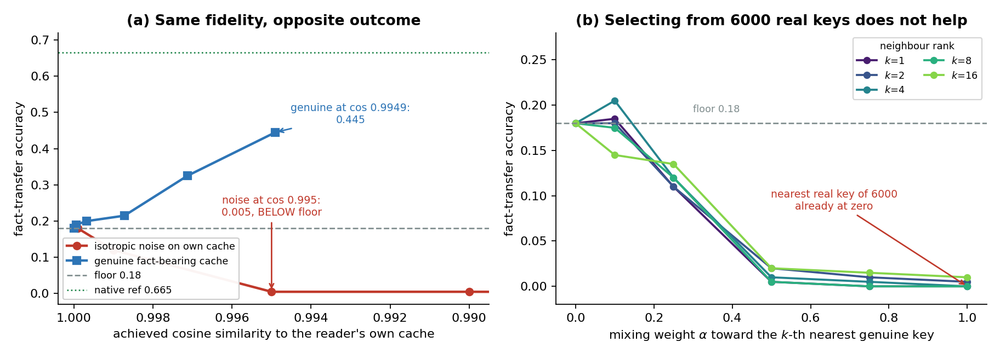
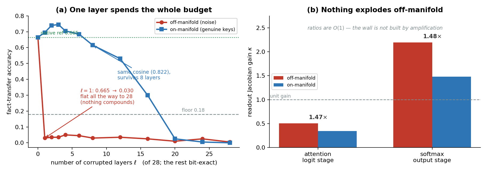
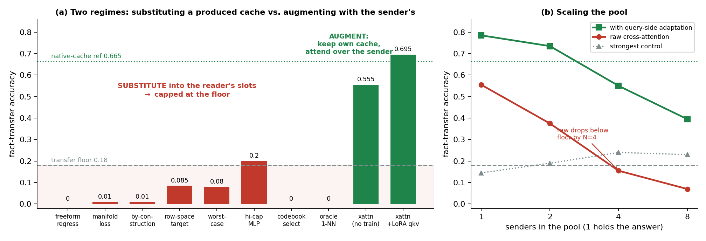

# 差得近：KV cache 的「保真度」与「可消费性」是两回事

> 原文：[abs](https://arxiv.org/abs/2610.22016) · [PDF](https://arxiv.org/pdf/2610.22016)

> MIT + IBM 的负结果论文，专拆一个诱人的想法：多 agent 系统里模型之间用文本通信太浪费——发送方明明已经把文章读完了（KV cache 就是「读过的记录」），直接把 cache 塞给接收方替换它自己的，两个模型都冻结、零训练，多好？答案是不行，而且**败因在接收方**：冻结的 transformer 只认得「自己会写出的那种 cache」，这个集合（tolerable set）窄到什么程度——6000 个真 key 里最近的那一个都嫌远。几何上再像也没用，failure 不是渐进的。机制出在 attention softmax 的竞争性上。但换个设计（不替换、当额外上下文挂上去）就能超过接收方自己的基线。

## 背景与动机

多 agent 系统的通信瓶颈：文本是有损压缩，发送方把读过的东西投影成 token，接收方再付一遍阅读成本。于是有一波工作直接传 KV cache——阅读的天然载体，prefill 时反正已经算了，白送。

这类工作分三种姿势，论文的核心洞察就是把它们拆开：

- **替换（substitution）**：发送方的 cache 直接装进接收方的 KV 槽位，替换它自己的
- **增强（augmentation）**：接收方保留自己的 cache，把发送方的当**额外可 attend 的上下文**挂上去
- **拟合桥（fitted bridge）**：映射函数对着接收方自己的 cache 回归训练过（Heo 2026 的闭式 ridge map、Dery 2026 的 translator）——论文明确把负面结论的范围划开，不覆盖这类

零训练替换是最诱人的版本：任意两个冻结模型即插即用，不需要联合训练、不需要预先协商表示约定。**它恰好也是死得最透的版本。**

## 方法：三组测量钉死 tolerable set 有多窄

设定：reader 是 Qwen2.5-1.5B（冻结），任务是 SQuAD 改造的分裂上下文事实回忆——sender 读含答案的全文，reader 拿到挖掉答案的版本 + 一个来自 sender 的 cache，看 greedy 续写能不能吐出答案。两个锚点：floor 0.180（reader 自己的 cache 但答案被挖掉）、native 0.665（reader 自己读未挖除全文）。

### 测量一：cosine 相似度不预测可消费性

给 reader 自己的 cache 加校准过的扰动：cosine 0.9999 时准确率已经在 floor（0.180），0.999 掉到 0.120，0.995 崩到 0.005——**比没有信息的 cache 还差**（破坏了它对剩余上下文的使用）。反直觉的对照组：同一个冻结模型在未挖除全文上产生的**真 cache**，cosine 只有 0.9949（比 0.995 的噪声条件还「远」），transfer 却有 0.445。**cosine 把这两个条件的优劣排反了**——89× 的差距，同等的保真度，次序颠倒。

方法论炸弹：大量 KV 压缩/重建/共享论文用 reconstruction error 和 cosine 当评估指标。这篇证明这些指标可以无限逼近最优、而它们代理的能力根本不存在，甚至把坏方法排在好方法之上。**行为评估（在真正消费 cache 的 reader 上测）才是裁决。**

### 测量二：28 层坏 1 层 = 全坏

只破坏前 ℓ 层、后面 28-ℓ 层保持 reader 自己的 bit 级原样：off-manifold 扰动下 ℓ=1 就从 0.665 掉到 0.030，曲线 ℓ=1 到 28 完全平坦——**伤害一次性完成，不随深度累积**。这直接排除了「逐层小误差指数放大」的流行解释（那会预测渐变曲线）。on-manifold 对照组（换成 reader 在其他文章上产生的最近真 key）在同 cosine 下确实渐进衰减：1 层能活（0.695，还略有益），8 层才开始衰，28 层全换才归零。同保真度、不同出处（provenance），命运天壤之别。

跨 7 个模型（6-36 层，Pythia/Qwen2.5/GPT-2）复测：全替换 transfer 全部 ≤0.008。浅模型不更宽容——失败发生在每层都有的消费点上。

### 测量三：6000 个真 key 里挑最近的也没用

「构造有问题，那就选吧」——从 reader 自己在其他文章上产生的 6000 个真 key 库里给每个 slot 检索最近的：**transfer 0.000**。混合权重 α=0.5 就崩到 0.005。9 种变体（真 key 库/学习码本/PCA 格点 × 三种 snap 规则）最好的格子 cosine 0.880、attention-logit 相关 0.928，transfer 照样 0.000。**流形成员身份是必要条件，远远不是充分条件**——「是 reader 会产生的那种 key」不等于「是这个位置上 reader 会产生的 key」。

## 机制：softmax 是竞争性消费

两个替罪羊被实验排除：

- **不是放大**：off-/on-manifold 的 readout 增益是 O(1)（1.47×），logit 阶段甚至衰减。GQA group size 带来的每 head 读出是唯一解析常数，太小。
- **不是深度累积**：见测量二的平坦曲线。

真凶在 cache 进入计算的那一点：**attention softmax(qK^T/√d)V 是竞争性的**——key 之间互相比赛抢 query，输出由谁赢、赢多少决定，跟 cache 离任何范数的距离无关。一个几何上小到测不出的位移可以翻转一场势均力敌的比赛；一个更大的位移如果沿着没人竞争的方向就毫无影响。而且比赛数量巨大（每个 query × head × layer 一场），中等上下文一次要跑几万场——**宽容 = 赢下每一场**。

这个解释统一了文献里的正负结果：tolerance 是各向异性的——reader 注意力不分辨的方向上很宽（所以同模型压缩/量化/逐 token 驱逐都成功：producer 和 reader 是同一个模型，扰动天然落在宽方向），注意力分辨的方向上极薄（跨模型生产的 cache 没有理由尊重这个方向取向）。一个推论也被验证：key 定比赛、value 只是被加权平均，所以 key 伤比 value 伤致命得多（同稀疏度下 13/256 个 value 坐标毁掉免费，key 同样毁是致命的，cosine 又把两者排反）。

**为什么文本通信反而行？** 文本从接收方自己的 encoder 重新进入，发生在任何 attention 之前——借来的 cache 没有这个入场通道。

## 出路：增强不是替换

只改放置方式：reader 保留自己的 C\*，attend over [C\*; C_sender]，sender 的 cache 原封不动挂上去。

- 零训练参数：transfer 0.555，三倍于 floor，超过整个替换家族
- query 侧 LoRA（rank 16）：**0.695，追平 native 参考 0.665**
- 最干净的对照：同一个模型写的含答案真 cache，替换进槽位 0.445 vs 当上下文挂上 0.555——**放置比保真度更值钱**

多 sender 场景：reader attend 8 个 sender 的 cache 并集（只有 1 个读过答案），无差别 attention 4 个 sender 就跌破 floor（干扰项淹没信号），query 侧适配的桥衰减平缓（N=1 时 0.785 → N=8 时 0.395，仍高出 floor +0.165）——**query 侧适配是 cache 池在规模增长时保持可用的关键**。

### 关键图表

**图 1：cosine 不预测可消费性**

> (a) 各向同性噪声在 cosine 0.995 就跌破 floor，而 cosine 更远（0.9949）的真 cache transfer 0.445——同保真度 89× 差距，次序颠倒。(b) 6000 真 key 库检索：对邻居排名 k 平坦、对混合权重 α 崩塌——6000 里最近的真 key 也进不了 tolerable set。[arXiv 原图](https://arxiv.org/html/2610.22016v1#S3)

**图 2：两个错误解释的排除**

> (a) 破坏前 ℓ/28 层：off-manifold 在 ℓ=1 一次到位且平坦（无深度累积），on-manifold 同 cosine 下 8 层内可存活。(b) off/on-manifold 读出增益 1.47×（O(1)）、logit 阶段 <1——不是放大。[arXiv 原图](https://arxiv.org/html/2610.22016v1#S4)

**图 3：全扫描的两种命运**

> (a) 八种替换方法（回归/流形损失/列空间/最坏 hinge/全宽 MLP/码本选择/oracle 真 key）全部贴 floor，两种增强全部越过——放置决定命运，构建质量无关。(b) sender 池扩展：无差别 union 注意力 4 sender 跌破 floor，query 适配的桥到 8 sender 仍可用。[arXiv 原图](https://arxiv.org/html/2610.22016v1#S5)

## 复现要点

- 未开源（MIT ORC/CSAIL + IBM Research）。reader Qwen2.5-1.5B（GQA group 6，28 层），probe 是 SQuAD 改造：n=200 项，greedy 8 token，判分是答案串包含。
- 最容易复现的钩子是测量一：给自己模型的 KV 加各向同性噪声扫 cosine，在分裂上下文 probe 上测 transfer——几十行 PyTorch hook 就能验证「0.9999 已在 floor」。
- 论文附了完整的证伪条件（C1/C2/C3 各配反例观察），以及一个机制预言：softmax 之前被消费的载体（residual-stream 激活，经归一化+线性映射+残差读出）应该显著更宽容——初部结果方向一致但未做匹配位移的受控版。

## 启发与局限

- 对这个知识库直接相关：10-10 精读的 KV-Repurpose（非前缀复用试验台）、10-14 的 LatentRemedy（latent token 修复复用失配）都在这条线上。LatentRemedy 的设计（插几个任务条件 latent token 帮 reader 消化共享上下文）在本文框架下正好是 augmentation——它成功的原因有了理论解释。**「近似放在提案侧、精确放在验证侧」的投机解码哲学，在 cache 共享领域的对应版本是「外来的当上下文、自己的留原位」。**
- 评估指标层面的教训值钱：cosine/MSE 可以优化到最优而目标能力缺席。任何用重建误差证明 KV 压缩无损的工作都该补一个行为评估。
- 与昨天 KV4-RL 有趣的对照：INT4 量化 + Hadamard 旋转能保住学习质量，因为旋转打散离群值后量化误差近似各向同性、落在注意力不分辨的宽方向——这正是「宽方向真的宽」的实证。跨模型替换则没有这种运气。
- 局限（作者自认很诚实）：单一 reader、单一 probe（短事实回忆对 attention margin 最敏感，长程分散依赖的任务可能更宽容）；augmentation 结果是同架构内（跨家族在维度匹配处就失败）；fitted bridge 未测（明确划为 non-claim）；anchors 是测量基线不是证明界。

## 疑问清单

- tolerable set 的「薄方向」能否显式估计？如果能拿到 reader 注意力敏感方向的子空间，把替换 cache 的残差投影到正交补上——是不是一个「sender 侧也能做」的修复？（论文断言 sender 侧没有所需信息，但没证明。）
- LatentRemedy 的 latent token 是 augmentation 的特例，那 KV-Repurpose 试验台里 segment 级复用的成功案例（10-10 笔记：63.9% 命中率）为什么行？——可能因为那是**同一个模型**跑不同 prompt（宽方向），不是跨模型。值得翻回去对照。
- residual-stream 载体（softmax 前消费）的受控实验如果证实更宽容，多 agent 通信的载体选择会整体改向吗？传输体积问题（residual stream 比 KV 大）论文没讨论。

## 新学到的术语

- **Tolerable set（可容忍集）**（learning）：冻结 reader 能正确消费的 cache 邻域；各向异性——注意力不分辨的方向宽、分辨的方向极薄，任何范数指标都测不出
- **Fidelity-Consumability 解耦**（learning）：cache 与 reader 自己的几何相似度（保真度）和 reader 能否实际使用它（可消费性）是两个独立谓词，cosine/MSE 可优化到最优而可消费性缺席
- **竞争性注意力（Competitive attention）**（learning）：softmax 让 key 互相比赛而非对标阈值，输出由比赛胜负决定——微小位移可翻转势均力敌的比赛，cache 替换失败的机制根源
- **On-manifold（流形上）**（learning）：某模型真实前向能产生的对象（如它在其他上下文产生的真 key）；流形成员身份是可消费的必要非充分条件
