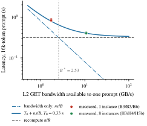
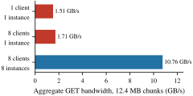
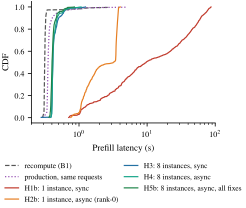

# 当 KV cache 比 GPU 还慢：远程 KV 层扩展实录

> 原文：[abs](https://arxiv.org/abs/2610.21500) · [PDF](https://arxiv.org/pdf/2610.21500)

> Multiverse Computing 的生产实战复盘。部署 GLM-5.3（FP8 MoE + MLA）到 8×B300 节点跑 prefill context parallelism，给 vLLM + LMCache 加了层远程 KV 存储（Valkey）——结果 16k token 的 TTFT p99 从 3.96s 暴涨到 17.3s，只能回滚。这篇论文讲清楚了一件事：**GPU 太快之后，「读缓存」这个默认假设会破产**。命中一次要 0.88s，重算只要 0.31s——缓存比算还慢。修完之后 p99 从 83.32s 降到 0.67s（124×），全部改动已提上游 LMCache。

## 背景与动机

长 prompt 的 prefill 主导 TTFT，标准优化是 prefix cache 复用：本地 host memory 一层（L1），再配个所有引擎共享的远程层（L2）。远程层看着很美——容量与引擎数解耦、跨引擎复用、重启不丢。

但这一切的地基是个没被检验的假设：**加载 KV 比重算便宜**。生产环境一开 L2，中位数 TTFT 没变、尾部炸了（p99 ×4.4），团队回滚并决定搞清楚为什么。

用回放生产请求流的方法隔离测量，三个原因浮出水面：

1. **命中比 miss 还慢**：16k prompt 重算 0.31s，从 L2 加载要 0.88s。B300 节点 prefill 速度 52.2k token/s，L2 路径的带宽根本喂不满 GPU 的消费速度。
2. **同步加载在高压下不稳定**：加载发生在 engine step 里，PCP8 下 8 个 rank 锁步推进，一个 rank 慢全体等。当到达率 × 单次命中时间 > 1，引擎变成不稳定排队系统——6 分钟内中位延迟从 3.52s 涨到 52.30s，而 GPU 只用了 7%。
3. **三个客户端 bug 造成无限停顿**：丢 completion 的竞态、miss key 的 GET 永不返回、async GET 用错 key——每个都能把引擎冻住 3-10 秒甚至永久。

## 方法

### 成本模型：两项就把问题说透

T_load = T₀ + ns/B（固定开销 + 传输），T_recompute = n/R。两个推论：

- **盈亏平衡带宽 B\* = sR**：s 是每 token KV 字节数（GLM-5.3 FP8 是 48.4 KB/token，MLA 下与 head 数无关），R 是 GPU prefill 速率。乘起来 **2.53 GB/s**——prompt 长度约掉了，阈值只跟模型 KV 足迹和硬件速度有关。单个 Valkey 实例最多给 1.71 GB/s，**每次命中都比重算慢**。
- **固定成本 T₀ ≈ 0.33s**（调度、lookup 往返、尾部 token 前向、逐 chunk 元数据交换广播）：意味着短于 R·T₀ ≈ **17k token** 的 prompt，**任何带宽下命中都不可能比重算快**。16k 的 L2 命中在中位延迟上永远赢不了，它的价值只在省 GPU 算力（prefill 引擎饱和时的容量价值）。

一句话：**GPU 越快，B\* 越高，缓存层的门槛越高**——判断缓存层好坏的参照物是它服务的硬件的 prefill 速率，不是网络延迟。

### 修复：把 KV I/O 摊到 8 个 rank 上

原始设计里 MLA 的 KV 只从 rank 0 存取（TP 下各 rank 持有相同 latent，合理），但 PCP 下 AllGather 之后 latent 全 rank 复制，rank 0 一个 rank 搬整个 prompt 的 KV 到 host memory，其余 7 个 rank 在 collective 处干等——Nsight 抓到 rank 0 写了 19.1 GB、每个 rank 白等 1.55s。

改动四件套：

1. **chunk 按 c mod W 分片到 rank**：每 rank 只存取自己的 chunk，L1 变成 1/W 切片，总内存不变。 Proposition 1 证明：现有调度器的「各 rank 报告第一个缺失 chunk、取最小」协议在分片下恰好返回最长已缓存前缀——**零新消息**。
2. **远程层按 rank 分区**：因为分片是静态的，rank r 只碰自己的 chunk，所以每 rank 配一个专属 Valkey 实例（URL 里 `{rank}` 替换即可），无集群协议、无客户端哈希、跨引擎复用照常。GET 带宽 1.71 → 10.76 GB/s（6.3×）。
3. **异步加载**：慢加载只拖累自己的请求，引擎继续跑别的。分片版异步查找等价性有 3000 组随机存在性模式测试。
4. **修三个 bug**：锁住 submit-and-register 消竞态；RESP 解析器按 CRLF 解析（miss key 返回 5 字节 null，老代码按 11 字节头读直接挂死连接）；async GET 改写 worker-0 key。

加载协议有个精巧设计：每 rank 跑完全相同的 collective 序列（无论本地找到什么），本地失败只通过交换消息上报、变成更短的一致前缀——**任何 rank 都不会跳过别人会进的 collective**，PCP 锁步下永远不会挂起。

### 关键图表

**成本模型 vs 实测**

> T₀ 只在一个点上拟合，模型准确预测了未参与拟合配置的延迟（0.79s vs 实测 0.83-0.88s）。虚线是重算中位数——单实例下每次命中都在虚线之上。[arXiv 原图](https://arxiv.org/html/2610.21500v1#S4)

**GET 带宽扩展**

> 同一实例加 8 个客户端只涨 13%（Valkey 单线程执行命令，I/O 线程只并行 socket 读写）；每 rank 一个实例才能线性扩到 10.76 GB/s。[arXiv 原图](https://arxiv.org/html/2610.21500v1#S6)

**修复前后的延迟 CDF**

> 单实例同步加载（H1b）引擎永远追不上（p99 83.32s，GPU 7% busy）；8 实例分片 + 异步 + 全部修复（H5b）p99 0.67s，分布贴住生产引擎——而且 98.5% token 来自 L2。[arXiv 原图](https://arxiv.org/html/2610.21500v1#S6)

## 实验

- **命中率 98.5% 的重负载流**：H1b（单实例同步）p99 83.32s → H5b（全修复）0.67s，**124×**；中位 0.40s 全程平稳（首尾三段都是 0.41/0.40/0.40s）。
- **与重算的残余差距**：H5b 中位仍比重算慢 0.09s——传输只占 0.074s，剩下是 T₀。**即使带宽无穷大，16k 命中也要 0.33s**，仍略慢于重算；但尾部更好（p99 0.67 vs 1.28s）且不吃 GPU 算力。
- **prefill 吞吐**：分片存储 +14%；顺带发现并修了 FlashInfer 的 SwiGLU+FP8 重量化 kernel（EP8 下大部分线程块在处理别的 GPU 的 slot，1.57ms → 0.23ms，PR #3969），合计 **+34%**（57.3-58.0k tok/s），已贴近不开 LMCache 的水平。
- **端到端**：5 节点 disaggregated 部署（4 prefill + 1 decode）过 200k SLA 基准，每节点 TPM 2.55M（对照旧聚合部署 11 节点才 7.74M）。
- **正确性**：bit-exact 不可用（引擎本身非确定），改用 6 组大海捞针（12.8k-166.7k token）四路对比，缓存答案与冷跑答案的差异不超过两次冷跑之间的差异；36/36 并发、1549 请求 30 分钟 soak 零错误。

## 复现要点

- 全部改动已提上游：LMCache PR #5545（分片存储）、#5548（per-rank URL）、#5553（异步加载）、#5547/#5550/#5551（三个 bug fix），FlashInfer PR #3969。**直接 vLLM + LMCache 最新版可复现**。
- 关键配置：GLM-5.3 FP8 + PCP8 + EP8，vLLM 0.31.0 / LMCache 0.5.5+ / Valkey 8.1（16 I/O 线程）。chunk 256 token、12.4 MB/chunk。
- 成本模型可以拿来即用：任何部署先算 B\* = sR 和 R·T₀ 两个数，就知道自己的缓存层值不值。换 B200/H100 只需重测 R。
- 论文自曝局限：每条件只跑一次（10% 以下差异不可靠）、只有 prefill 无 decode 交接、单一 prompt 长度桶、hit-heavy 子集是为塞进私有 Valkey 挑的。

## 启发与局限

- **「recompute 是个 demanding baseline」是全文最值钱的一句话**。B\* = sR 随 GPU 代际增长——B300 上 2.53 GB/s，下一代更高。通用 KV 服务器（Valkey/Redis 单线程模型）天然追不上，要么随引擎并行度 scale-out（本文方案），要么上 RDMA（Mooncake 路线），要么压 s（CacheGen 类压缩）。
- 与 KV4-RL 映射同一个母题的两面：KV4-RL 压 s（INT4 让每 token 字节减半再减半），这篇抬 B（分片 + 每 rank 实例）。成本模型 T₀ + ns/B 把两条路统一了——但 T₀ 是两条路都躲不开的地板，17k token 以下的命中永远不划算。
- 排队论视角（λ·ns/B > 1 即不稳定）给「缓存层慢」和「缓存层炸」之间画了条清晰的线：慢只是浪费，不稳定才是事故。同步加载把慢放大成不稳定，是这次生产事故的真正机制。
- 局限：hit-heavy 98.5% 是理想化负载，生产 LRU 驱逐下 EXISTS-GET 竞态会更多；T₀ 的 17k 阈值是预测未实测；MLA 特有结论（latent 与 head 数无关）对 GQA 模型不直接成立——GQA 下 TP 切 head，每 rank KV 天然是 1/W，分片动机会弱一些。

## 疑问清单

- T₀ 的构成里「逐 chunk 广播」占多少？16k prompt 是 64 次 broadcast——如果按 owner 批量合成一次 AllGather 式 collective，T₀ 能压到多少？论文留作 future work，改动量看起来不大。
- 跨引擎复用在分片下「照常工作」，但多引擎同时打同一个 Valkey 实例时带宽怎么分？论文只算了「6 引擎 × 0.45 req/s ≈ 2 GB/s < 10.76」的估计值，没测。
- 与 CacheGen 式 KV 压缩叠加：压 s 直接降 B\*，为什么这篇不做？（可能因为 MLA latent 已经很紧，再压会伤正确性——但论文没讨论。）

## 新学到的术语

- **Break-even bandwidth（B\* = sR）**（learning）：缓存命中开始划算所需的传输带宽 = 每 token KV 字节 × GPU prefill 速率；prompt 长度约掉，GPU 越快门槛越高
- **Prefill Context Parallelism（PCP）**（learning）：prompt 沿序列切到多 GPU，rank 间用 AllGather 交换 KV，全部锁步推进——任何一个 rank 的停顿都会拖住全体
- **单服务器队列不稳定条件（ρ > 1）**（learning）：到达率 × 服务时间 > 1 时队列无稳态、延迟发散；同步加载把慢缓存变成不稳定队列的机制
