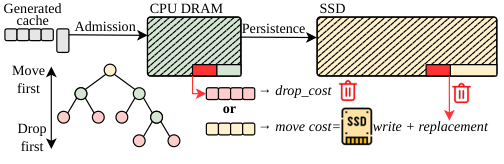

# Gandalf：KV offloading 正在把 SSD 写死——按「注意力类型」分层安置，寿命延长 7.3 倍

> 原文：[abs](https://arxiv.org/abs/2610.30791)（UChicago + Samsung + TensorMesh）

## 背景与动机

多轮对话和 agent 负载的 KV cache 早就装不下 GPU+DRAM 了（SemiAnalysis Claude Code trace 推算：混合注意力模型每天产生 81-240 TB KV 状态），SSD 成为标准扩容层。但 SSD 有个物理天花板：NAND 闪存只能写有限次数（TBW），生产负载的写入量把 SSD 寿命从「几年」压到「几个月甚至几天」。

自然的对策是少写点——按历史访问模式过滤准入（比如「复用过 N 次才落盘」）。但这有个致命盲区：**不同注意力类型产生的 KV，历史访问模式可以一样、未来复用却完全不同**。混合架构（full attention + 线性/稀疏 attention）的复用差异是结构性的：

- **full-attention KV**：每轮新对话都要读全部历史前缀——每条 KV 会被后续每一轮复用，越早写入复用越多
- **线性注意力状态 / 滑窗 KV**：只用来生成紧接着的下一段回复，用完即弃——基本是「一次性」数据

把大量一次性数据写进 SSD，白白烧写入寿命还挤占容量。Claude Code WEKA trace 验证：大多数线性注意力状态只复用一次或零次。

> 图源：[arXiv 2610.30791](https://arxiv.org/abs/2610.30791) Figure 4

## 方法

核心洞察：**准入决策要用应用层信息（注意力类型），不能只看访问模式**。

- 分层安置：full-attention KV 优先入 SSD（长命、高复用），线性/稀疏状态留在 host DRAM（短命）
- 但刚性分层会撞「硬件-利用率不匹配」：并发会话多时线性状态也可能爆 DRAM，长上下文时 full KV 也可能爆 SSD。所以要做**容量感知的柔性准入**——按各层利用率与压力动态放宽/收紧
- 先离线 oracle（联合优化准入+驱逐）蒸馏出两条设计原则：保护前缀命中边界、准入的期望复用价值要超过「写入成本+驱逐代价」；再落成在线策略
- TTFT 保护：满载时全 KV 命中从 DRAM 挪去 SSD 会伤首 token 延迟（SSD 带宽低），策略里显式权衡

## 实验

- SSD 寿命平均延长 **7.3×**，cache 命中率几乎不受影响
- 覆盖多负载 trace（Claude Code 等）× 多硬件容量配比（DRAM/SSD 比例扫描）
- 对比基线：无过滤全写入、频率过滤（N×复用才写）
- 设计可扩展到 High Bandwidth Flash（HBF）——三星合作方的现实利益

## 复现要点

- 论文未附代码链接，但核心策略（注意力类型打标签 + 分层准入）可在 LMCache/AirCache 类系统上实现
- 负载模型关键假设：多轮对话每轮读全部前缀（full KV 复用 ∝ 轮数）、线性状态只用一次——换 workload（如单轮 RAG）结论会变，复现时先验证这个 trace 特征
- endurance 模型：T_SSD = E_TBW / (WAF × E_workload)，WAF（写放大因子）是隐藏变量，GC 压力大时寿命缩水更快

## 启发与局限

- 这是「应用语义下沉到存储层」的漂亮案例：KV offloading 系统过去把 KV 当不透明字节块，Gandalf 证明 attention type 是免费的高价值元数据——与 10-16 Remote KV Tiers（缓存层要对着 GPU prefill 速率评）同一精神：**存储层决策必须懂推理负载**
- 与 AKV（10-21）形成上下游：AKV 在 GPU 侧决定「哪些 KV 该 drop」，Gandalf 在 SSD 侧决定「哪些 KV 该进」——agent 时代的 KV 生命周期管理正在成为独立子系统
- 局限：依赖混合架构的普及（纯 full-attention 模型没有类型信号）；oracle 蒸馏的在线策略在负载突变（如新 agent 模式）下的适应性未充分验证

## 疑问清单

1. 线性注意力状态的 DRAM 驻留会挤占 full-KV 的 DRAM 缓存空间吗？两者容量博弈的最优比是多少（Figure 5 扫了，值得细看）
2. KV 量化（FP8/INT4 KV）与 Gandalf 正交——量化后写入量直接减半，为什么论文不叠加？（可能因为量化属于另一层，但工程上必然组合）
3. HBF 场景的 WAF 和带宽特性与 NVMe 差异多大，7.3× 能否迁移

## 新学到的术语（同步到 glossary/terms.yaml）

- TBW / DWPD（SSD 写入寿命指标）
- WAF（Write Amplification Factor，写放大因子）
- Attention-Type-Aware Placement（注意力类型感知安置）
